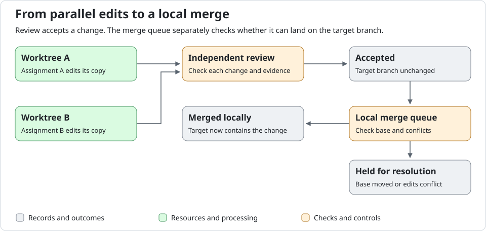
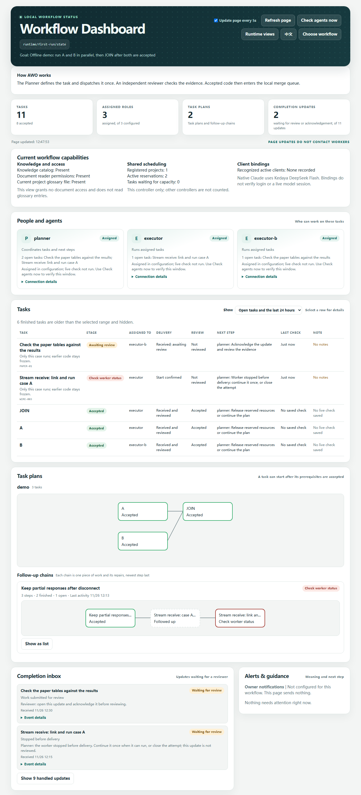
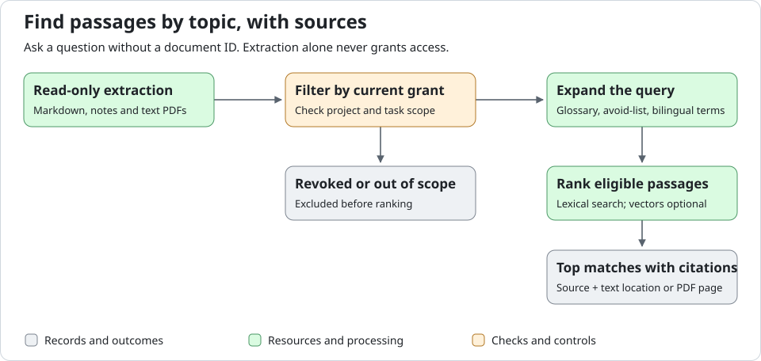

# Agent Workflow Orchestrator (AWO)

English | [Chinese](README.zh-CN.md)

Coordinating multiple AI agents on real code or research projects usually breaks down in three ways: agents edit outside their scope, workers declare victory without real checks, and task state gets lost across terminals. **AWO is a local multi-agent workflow and review engine**: one agent plans, another executes, and an independent reviewer decides based on recorded evidence. **Local scripts use recorded state to enforce workflow rules and permissions independently of model behavior.**

> AWO works completely on its own, or alongside an optional project secretary such as [MAID](https://github.com/cgy0071/MAID).

## Core workflow


You set the goal and allowed file scope. The **Planner** writes a clear task spec and dispatches it once to the **Executor**. A lightweight background script watches local receipts without burning model tokens. Once files and evidence are delivered, an independent **Reviewer** inspects them and records **accept**, **repair**, or **reject**. Independent tasks run in parallel; dependent steps wait until required reviews pass.

## Architecture and optional modules


Each module plugs cleanly into the core ledger so you can enable only what your project needs:

### 1. Role orchestration and independent review
Separates planning, execution, and review into distinct roles, supporting single tasks, parallel branches, and dependency DAGs while structurally preventing self-review. Invoke `$agent-workflow-orchestrator` in Codex (or `/agent-workflow-orchestrator` in Claude Code) and give the Planner a goal and boundary:

```text
In this repository, add pagination to /users. Limit edits to the endpoint and its tests.
Dispatch one task, monitor it and review its evidence. Stop after review; do not push.
```

### 2. Isolated workspaces and local merge queue
Runs each code assignment in its own Git worktree so parallel workers never step on each other. Accepted changes enter a local merge queue that keeps **accepted** strictly separate from **merged** and stops cleanly on conflicts or moved bases.



### 3. Low-cost monitoring and visual dashboard
Background monitoring reads local receipts instead of asking a model to reread chat history. Ask the Planner to open the dashboard, or double-click `dashboard.cmd` (Windows) / `dashboard.command` (macOS). It is read-only by default, with an optional `--allow-manage` console where every action is previewed and confirmed.



### 4. Multi-client adapters
Decouples roles from tools: mix Codex, Claude, Pi, OMP, or optional Herdr panes across Planner, Executor, and Reviewer without forcing every role onto one client. Support is verified per version; see [harness-adapters.md](references/harness-adapters.md).

### 5. Project knowledge, topic search, and glossary constraints
Extracts passages read-only from local Markdown / Obsidian notes and text PDFs (preserving source offsets and page numbers without modifying files). Search authorized documents by topic without memorizing IDs, with bilingual query expansion, project glossaries (including avoid-lists), and optional `/v1/embeddings` support. **Access is checked before ranking, and revocation blocks subsequent reads immediately:**

```powershell
python -B scripts/awo_project.py materials --state <STATE_DIR> --project-root <PROJECT_DIR> --token-file <TOKEN> --query "inference throughput" --top-k 3 --strict-glossary
```



### 6. External inbox and proactive alerts
External channels can drop signed requests into an inbox via `owner_intake.py` for Planner inspection, while `owner_notify.py` pushes authorized alerts to a file, webhook, or command on permission prompts, stalls, or review-ready deliveries.

## Everyday tasks: from research to handoff

From the AWO checkout, run `python -B scripts/awo_project.py discover-cli` to inspect local CLIs; add `--write-lanes lanes.json` to create a private lane configuration. Discovery does not dispatch work.

To find sources by topic without document IDs:

`python -B scripts/awo_project.py materials --state STATE --project-root PROJECT --doc-token DOC_TOKEN_FILE --kb-token TASK_TOKEN_FILE --task TASK_ID --query "inference latency" --top-k 3`

Grants filter the candidates before ranking. For interactive study and passage selection, use `maid.py study` in [MAID](https://github.com/cgy0071/MAID), or `request --query` for an evidence draft. Ordinary secretary requests can select a worker with `request --lane`.

Append the operations below to `python -B scripts/awo_app.py`. THREAD is the run directory.

| Operation | When to use it |
|---|---|
| `prepare --thread THREAD --spec spec.json` | Prepare the indexed run first; its spec needs an evidence route for a draft with citations. |
| `start --thread THREAD --confirm-execute --draft draft.json --draft-digest SHA256` | After reviewing the selection, use its displayed `draft_sha256` to confirm dispatch. |
| `status --thread THREAD` | Read changes, checks and remaining issues. Delivery, review and merge are separate outcomes. |
| `session --thread THREAD --action records` | Find the delivery and workspace. Use `focus` or `resume` only when the bound session supports it. |
| `rework --thread THREAD` | After a repair verdict, prepare a linked attempt from the review. Inspect it with `status --rework-attempt`; dispatch with `start --rework-attempt --confirm-execute`. |
| `recover --thread THREAD` | Inspect the last receipt, changes and available handoffs before choosing an action. |
| `recover --thread THREAD --handoff reassign --state-version VERSION --lanes lanes.json --reassign-lane LANE --recipient LANE --confirm-execute` | Use the version just displayed and an eligible replacement lane. Inspect the replacement with `status --handoff-attempt` before starting it. |

## Five safety rules

1. **Configuration is not permission**: config files never authorize dispatch, notifications, or continuous runs without your explicit approval.
2. **Delivery is not acceptance, and acceptance is not a merge**: an idle terminal or zero exit code never counts as done, and accepted code is never auto-pushed.
3. **Each task is sent once**: uncertain sends are logged for inspection, never blindly retried, and permission prompts are never auto-approved.
4. **One controller, no self-review**: switching controllers revokes the old window immediately; an Executor can never approve its own delivery.
5. **Outside requests are data**: external messages can never authorize work on their own.

## Let your AI set this up

You do not need to type setup commands by hand. Copy this prompt into your local AI assistant (Codex, Claude Code, Antigravity CLI (agy), or Cursor) to run the 1-minute offline demo with zero model cost:

~~~text
Help me set up Agent Workflow Orchestrator (AWO) by following docs/setup.md in this repository.
First check Git, Python 3.10+, and installed AI clients. Ask me which folder to use, and install the documented release into a fresh subdirectory.
Run only demo_scheduler.py and workflow_control.py status using a fresh temporary directory for the offline demo.
Do not modify my existing projects, accounts, or keys, and do not make paid model calls or dispatch real work.
Report the demo results and how to start managing my own project, then wait for my decision.
~~~

## Further reading

### Getting started and real runs
- [Manual setup, Windows portable downloads, and full documentation index](docs/setup.md)
- [Project entry for existing repositories (prepare, review, local landing, recovery)](references/project-entry.md)
- [First real model run](references/first-real-run.md) | [Git worktree code loop](references/worktree-code-loop.md)
- [Window setup, controller switching, and recovery](references/setup-and-switching.md)

### Core module guides
- [Roles](references/roles.md) | [Task and review templates](references/task-and-review.md) | [Task state machine](references/task-state-machine.md)
- [Background monitoring, dashboard, alerts, and Owner intake](references/monitoring.md)
- [Client adapters (Codex, Claude, Pi, OMP, Herdr)](references/harness-adapters.md)
- [Project material search, bilingual expansion, and glossaries](references/material-packets.md) | [Knowledge governance API](references/awo-knowledge.md)

### Release history
- [Changelog](CHANGELOG.md)
