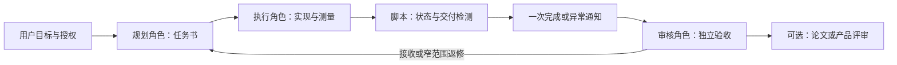

# Agent Workflow Orchestrator

可配置的多角色 Agent 工作流 Skill：**任务规划 → 执行 → 脚本监控 → 完成通知 → 独立审核 → 继续派工**。

独立于具体工程、模型和客户端。默认提供 **Planner / Executor / Paper Lead**，也可替换为软件开发、产品交付、研究实验等角色组合。

## 功能

- **可改角色**：调整角色名称、数量、职责、权限及交付物，不将角色绑定到模型。
- **可改架构约束**：在配置中定义项目约束、允许的改动和准入阶段，不内置某个工程规则。
- **跨 harness**：任一角色可使用 Codex、Pi、Claude、dsh-tui、Grok 或其他工具。
- **可改自动化策略**：轮询间隔、超时、完成判据、审核者、审核后动作和停止条件均可配置。
- **低成本监控**：工作期间只查状态，不反复用模型读取完整对话。
- **完成后唤醒审核者**：核验身份、任务和交付，发送一次通知，由审核角色继续已有授权计划。
- **防重复**：唯一任务/nonce、新完成序列、监控锁和通知尝试记录；不把 idle 当成功，不盲目重发。
- **独立证据审核**：监控的 `review_ready` 只代表收到交付；是否通过由配置指定的角色判断。

## 默认分工

| 角色 | 主要工作 | 默认交付 |
|---|---|---|
| Planner / Engineering Lead | 分析、设计、任务拆分、审核、后续决策 | 方案、任务书、审核和决策 |
| Executor | 实现、实验、测试、测量和首差定位 | RESULT / EVIDENCE / HANDOFF、变更和日志 |
| Paper Lead | 科学问题、相关工作、创新判断、论证和稿件 | claim–evidence、补证请求、论文稿 |

这些是模板，不是固定组织结构。可以删去 Paper Lead、加入 Reviewer，或合并规划与实现，同时保留独立验收。角色职责与使用哪个 harness 无关。



## 安装

需要 Python **3.10+**，脚本只用标准库。实际 Agent 接入还需要相应客户端及其已核验的自动化接口。Herdr 是可选项，不是角色协议的依赖。

### Codex Skill

将仓库克隆到 Skill 目录。私有仓库需要当前账号具有访问权限：

```powershell
gh repo clone cgy0071/agent-workflow-orchestrator "$HOME/.codex/skills/agent-workflow-orchestrator"
```

也可放到当前客户端实际使用的 Skill 目录。刷新/重新打开会话后调用：

```text
使用 $agent-workflow-orchestrator。
按 workflow.json 的角色和阶段推进当前目标。
允许在该目标及已给定范围内自动派工、监控、审核和继续执行。
```

### Pi / Claude / dsh-tui / Grok

通过该客户端支持的 Skill/上下文加载机制载入 `SKILL.md`，或将其作为会话工作流指令，并提供配置路径。各客户端的自动发现目录和 CLI 参数可能不同，以实际版本为准；此仓库不改动客户端配置、认证或模型设置。

## 快速使用

### 1. 配置角色与流程

复制并修改 [`examples/workflow.json`](examples/workflow.json)：

```json
{
  "roles": {
    "planner": {"harness": "claude", "responsibilities": ["plan", "review"]},
    "executor": {"harness": "codex", "responsibilities": ["implement", "measure"]},
    "paper-lead": {"harness": "pi", "responsibilities": ["research", "write"]}
  },
  "architecture": {"constraints": ["retain public interfaces"]},
  "workflow": {
    "reviewer_role": "planner",
    "transitions": {"accept": "next_task_within_authorization", "repair": "new_scoped_repair_task"}
  },
  "automation": {"continuous_execution_authorized": true, "interval_seconds": 300}
}
```

配置是给 Agent 读取的工作流规则；它不会自行产生用户授权。监控脚本读取的是下面每项任务独立的 request.json，而不是自动解释整个工作流图。

### 2. 写任务并派发

按 [`references/task-and-review.md`](references/task-and-review.md) 写任务：目标、目录、允许改动、输入、验收、交付和停止点。发现并核验 Worker 的真实身份，检查当前任务/目录占用，保存投递记录后单次派发。若已有调度器和共享台账，复用它们。

Planner 不一定是 Codex，Executor 不一定是 Pi。昵称、模型与实际客户端分别记录；例如 Grok 可以是独立 harness，也可以是 Pi 中的模型。

### 3. 配置监控请求

从 [`examples/request.herdr.json`](examples/request.herdr.json) 复制到**新的任务目录**，填写实际 session、身份、完成序列、交付与授权。默认示例不能直接投递，必须替换占位值，并在确认执行已开始后设置 `dispatch_confirmed: true`。

监控支持三类 Worker：

| 适配 | 状态来源 | 使用场景 |
|---|---|---|
| `herdr` | 原生 agent get/read | Herdr 能准确识别的会话 |
| `command` | 经核验命令返回规范 JSON | 任意官方 CLI/API 外层适配 |
| `receipt` | 独立作业的任务绑定状态文件 | 任意支持单次非交互运行的 harness |

审核者支持 `herdr` 或 `command` 通知，发送前核验目标身份。完整合同见 [`harness-adapters.md`](references/harness-adapters.md) 和 [`monitoring.md`](references/monitoring.md)。

### 4. 开始监控

```sh
python scripts/monitor_task.py --request /absolute/task/request.json --check
python scripts/monitor_task.py --request /absolute/task/request.json --notify
```

`--check` 只检查本地请求。`--notify` 还需要请求内 `authorization.notify_reviewer: true` 及授权来源，否则不会发送消息。后台启动示例见 [monitoring.md](references/monitoring.md)。

默认每 **300 秒**检查一次，整体持续到完成或异常；不要求模型持续盯着终端，也没有一小时总时限。每次外部命令都有有限超时。

### 5. 自动审核与续派

监控发现新完成及合格交付后，保存哈希并一次通知审核会话。审核角色读取冻结请求、变更和原始证据，写结论，再按工作流和已有授权安排下一任务或返修。新任务使用新 ID/nonce；通知本身不等于新用户授权。

缺交付、blocked、身份变化、执行失败和不确定通知会单独记录。终端空闲或命令退出 0 不等于任务通过。

## 单次 CLI 作业

如果不使用 Herdr，可按 [`examples/job.json`](examples/job.json) 提供经过确认的实际单次命令：

```sh
python scripts/run_job.py --job /absolute/job.json
```

脚本以参数数组启动命令，输出状态文件、真实返回码和 output.log；receipt 适配据此监控。它不猜测 Codex、Pi、Claude、dsh-tui 或 Grok 的参数，不用于无单次模式的交互 TUI。交互 TUI 需可靠的状态事件桥接，未验证前标 `ADAPTER_NOT_VERIFIED`。

## 配置分层

| 层 | 可改内容 | 谁读取 |
|---|---|---|
| workflow.json | 角色、职责、架构、阶段、转移、自动化授权范围 | 协作 Agent |
| task.md | 本项目标、目录、输入、验收与停止点 | 执行及审核角色 |
| request.json | 实际身份、适配命令、交付判据、轮询与通知 | 监控脚本 |

任务身份、会话目标与授权不能由 Worker 自行替换来扩大权限。不要把凭证放进任务、argv 或仓库。`STOP_MONITOR` 文件只停止监控；取消正在执行的工作须按调度器授权另行处理。

## 测试与已验证范围

```sh
python scripts/test_monitor.py
```

离线测试覆盖五种 harness 标签、工作中不读对话、旧完成拒绝、身份变化、缺/空交付、错误 nonce、缺标记、blocked/失败、路径越界、通知去重、不确定通知不重试，以及真实本地子进程 → 回执 → 监控闭环。测试不会连接真实 Agent 或发送真实通知。

这些结果验证接口合同与自动化行为，**不表示所有客户端版本都完成现场连接测试**。首次接入需核验当前工具版本的身份、状态与精确会话投递接口；既有可用适配可复用。

## 目录

```text
SKILL.md                    技能入口
agents/openai.yaml          Skill UI 元数据
references/                 角色、任务、适配与监控合同
examples/                   可修改的工作流与任务请求示例
scripts/monitor_task.py      状态检测与一次通知
scripts/run_job.py           单次 CLI 作业回执
scripts/test_monitor.py      离线行为验证
```
