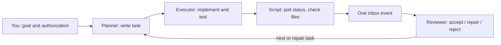

# Agent Workflow Orchestrator

English | [Chinese](README.zh-CN.md)

Let several AI coding agents work as a team: one plans and reviews, another implements, and a small Python script watches the work in between so nobody has to babysit terminals.

## What problem does it solve?

A typical setup without this tool: Claude plans in one window, Codex implements in another, and you keep switching between them, copying results back and forth, checking whether the work is "really" done, and deciding what to send next.

With this tool:

1. The **Planner** agent writes a task (objective, scope, acceptance criteria) and dispatches it once to the **Executor** agent.
2. A script polls the Executor's *status* every 5 minutes. It does not ask a model to reread the conversation, so monitoring costs almost nothing.
3. When the Executor finishes and the expected files (for example `RESULT.md`, `HANDOFF.md`) pass validation, the script records one completion event for the reviewer. Direct prompting is optional.
4. The reviewer checks the raw evidence, records `accept`, `repair`, or `reject`, and, if you authorized it, dispatches the next task.

The repository contains two parts:

- **The Skill** (`SKILL.md`): instructions that an agent loads so it knows how to plan, dispatch, review, and continue.
- **The scripts** (`scripts/`): standard-library Python tools for state, dispatch, monitoring, and review gates. The agent playing the controller usually runs them; you can also run them yourself.



Roles are not tied to tools. The Planner can run in Codex, the Executor in Claude, or any other combination.

## Try it in 30 seconds

Requires Python 3.10+. No agent account or network access is needed. From the repository root:

```sh
python -B scripts/demo_scheduler.py --directory runtime/first-run
python -B scripts/workflow_control.py --state runtime/first-run/state status --summary --format text
```

The demo builds a small task graph: independent tasks **A** and **B** become eligible together on two fake workers (local Python child processes). **JOIN** becomes eligible only after both are reviewed and accepted. The first command prints `OFFLINE_DEMO_PASS`; the status view shows A, B, and JOIN as `accepted`. Use a new directory for each run.

The demo checks scheduling, one-time dispatch, delivery validation, and review gates. It does not exercise a background polling loop, direct notifications, or compatibility with a real client (Codex, Claude, ...).

## Key concepts

| Term | Meaning |
|---|---|
| Role | A job in the workflow, such as Planner or Executor. Names, count, and permissions are editable. |
| Harness | The actual agent client running a role: Codex, Claude, Pi, dsh-tui, Grok, and so on. |
| Adapter | How the scripts talk to a harness: `herdr`, `command` (a verified CLI/API bridge), or `receipt` (status files written by a one-shot job). |
| Herdr | An optional terminal multiplexer for agent sessions. A **pane** is one Herdr terminal split. Not required. |
| Controller | The single active binding that can dispatch tasks; usually the Planner. A separately bound reviewer can record reviews. |
| Binding | A verified record that "role X is this exact session". Bindings are versioned; an old version loses authority after a switch. |
| State directory | A private SQLite ledger of bindings, tasks, events, and reviews. Created by `init`. |
| Task ID / nonce | Unique values per task that bind the dispatch message, request, and completion evidence; stale results are rejected. |
| Completion sequence | A counter reported by the worker. Only an increase after dispatch counts as fresh completion. |
| review_ready | Delivery files are present and valid. It means "ready to review", not "accepted". |
| Inbox | Where completion events wait. By default the reviewer is not prompted directly; it reads the inbox. |

## Who runs what?

| Step | Usually done by |
|---|---|
| Edit `workflow.json`, give authorization | You |
| Open agent windows and start the clients | You |
| Load the Skill into the controller agent | You |
| `init`, `bind`, writing tasks, dispatch, review commands | The controller agent, following `SKILL.md` (or you, manually) |
| Polling status and recording one completion event | `monitor_task.py`, running in the background |

## Installation

Clone the repository into your client's Skill directory. Examples:

```sh
# Codex
git clone https://github.com/cgy0071/agent-workflow-orchestrator.git "$HOME/.codex/skills/agent-workflow-orchestrator"
# Claude Code
git clone https://github.com/cgy0071/agent-workflow-orchestrator.git "$HOME/.claude/skills/agent-workflow-orchestrator"
```

For other clients (Pi, dsh-tui, Grok, ...), load `SKILL.md` through the client's own Skill or context mechanism, or paste it as instructions. Skill directories and flags depend on the client version. This repository never changes client configuration, credentials, or model settings.

In Codex, ask the controller agent to use `$agent-workflow-orchestrator`. In Claude Code, invoke `/agent-workflow-orchestrator`. Then give it the goal, `workflow.json`, and the scope of your authorization.

```text
Read workflow.json and follow its roles and stages for the current goal.
You may dispatch, monitor, review, and continue tasks within the authorized scope.
```

## First real workflow: one Planner, one Executor

The steps below show the order of operations. Run commands from the repository root; replace every `/abs/...`, `INSTANCE`, `TASK-ID`, and `EVENT_ID` with actual values. Use absolute paths for files outside the repository. Full commands and options are in [Initialization, Window Selection, and Handoffs](references/setup-and-switching.md).

### 1. Describe the team (`workflow.json`)

Copy [examples/workflow.json](examples/workflow.json) and edit roles, goal, and automation. Delete `paper-lead` if you do not need a research reviewer. A minimal shape:

```sh
cp examples/workflow.json workflow.json
```

```json
{
  "goal": "Add pagination to the /users endpoint",
  "roles": {
    "planner": {"harness": "claude", "responsibilities": ["plan", "review"]},
    "executor": {"harness": "codex", "responsibilities": ["implement", "test"]}
  },
  "workflow": {"dispatch_role": "planner", "execution_role": "executor", "reviewer_role": "planner"},
  "automation": {"continuous_execution_authorized": false, "interval_seconds": 300}
}
```

`harness` is only a label. It does not open or select a window.

### 2. Open the agents and describe how to reach them

Open one window/session per role, start the client, and pick the model. This command extracts starter binding specs from the example request; replace every placeholder with verified live identity and adapter settings before binding:

```sh
python -B -c "import json; r=json.load(open('examples/request.herdr.json')); r['worker'].pop('baseline_completion_seq'); json.dump(r['worker'],open('worker.json','w')); json.dump(r['reviewer'],open('planner.json','w'))"
```

`worker.json` comes from `worker`; `planner.json` comes from `reviewer`. The example uses optional Herdr. Prefer a verified native command bridge when available; its fields and the one-shot receipt alternative are in [harness-adapters.md](references/harness-adapters.md). A receipt worker cannot receive a scheduler dispatch; launch its job through the documented runner instead.

### 3. Create state and bind roles

```sh
python scripts/workflow_control.py --state /abs/state init --config workflow.json
python scripts/workflow_control.py --state /abs/state bind --role planner --spec planner.json --mode controller --policy inbox_only
python scripts/workflow_control.py --state /abs/state bind --role executor --spec worker.json --mode worker
```

`bind` queries the live session and refuses a mismatched identity. Save the controller `instance_id` and `version` it prints; later commands pass them as `--actor` and `--version`.

### 4. Write the task and its request

Start the task request in a new task directory:

```sh
python -B -c "from pathlib import Path; Path('/abs/task').mkdir(parents=True, exist_ok=False)"
cp examples/request.herdr.json /abs/task/request.json
```

- `task.md`: what the Executor should do. Include the exact task ID and nonce; use the [task template](references/task-and-review.md).
- `request.json`: what the monitor should check. Replace the example's `worker` and `reviewer` objects with the exact bound specs; add the Worker's observed `baseline_completion_seq`. Set a unique `task_id` and `nonce`, actual `cwd`, expected delivery files and marker, and `workflow_state` pointing at your state directory. Keep `dispatch_confirmed: false` until reconciliation.

Validate it without contacting any agent, then do a read-only identity check:

```sh
python scripts/monitor_task.py --request /abs/task/request.json --check
python scripts/monitor_task.py --request /abs/task/request.json --preflight
```

### 5. Dispatch once

Set `authorization.dispatch_worker` to `true` with a real authorization `source`. Set `authorization.notify_reviewer` to `true` only if you authorize direct prompting when the reviewer policy permits it. Ensure `task.md` contains the same task ID and nonce as `request.json`, then:

```sh
python scripts/workflow_scheduler.py --state /abs/state dispatch --request /abs/task/request.json --message-file task.md --actor INSTANCE --version 1 --context main
```

After you confirm the Executor actually started, write `EXECUTION.md` (task ID, nonce, `Outcome: running`, and what you observed), then produce a confirmed request:

```sh
python scripts/workflow_scheduler.py --state /abs/state reconcile --task TASK-ID --outcome running --evidence /abs/task/EXECUTION.md --request-out /abs/task/confirmed.json --actor INSTANCE --version 1 --context main
```

If you sent the task through another interface instead, use `register-task` as described in the setup guide. Details: [scheduling.md](references/scheduling.md).

### 6. Monitor

```sh
python scripts/monitor_task.py --request /abs/task/confirmed.json --notify
```

The monitor polls every 300 seconds by default and runs until completion or an exception. There is no default overall time limit, but each status query has a timeout. With `workflow_state`, `--notify` records an inbox event even when `authorization.notify_reviewer` is false. With `inbox_only`, it never prompts the reviewer directly. Background startup and the full status contract: [monitoring.md](references/monitoring.md).

### 7. Review and continue

```sh
python scripts/workflow_control.py --state /abs/state inbox
python scripts/workflow_control.py --state /abs/state ack --event EVENT_ID --actor INSTANCE --version 1 --context main
python scripts/workflow_control.py --state /abs/state review --event EVENT_ID --file /abs/task/REVIEW.md --verdict accept --actor INSTANCE --version 1 --context main
python scripts/workflow_control.py --state /abs/state next-check --event EVENT_ID --actor INSTANCE --version 1 --context main
```

The reviewer reads the raw evidence and writes `REVIEW.md` with the task ID, nonce, and verdict. `next-check` returns a `parent_review` record; put it in the next task's request to link the follow-up. Without `continuous_execution_authorized`, the controller stops here and reports back to you.

At any time, `workflow_control.py --state /abs/state status --summary --format text` shows each task's phase and the next expected action.

## Configuration files at a glance

| File | Contains | Read by |
|---|---|---|
| `workflow.json` | Roles, architecture constraints, stages, transitions, automation policy | Agents (as guidance) and `init` |
| `planner.json`, `worker.json` | How to reach each role's live session | `bind` |
| `task.md` | Objective, directory, allowed changes, acceptance, stop conditions | Executor and reviewer |
| `request.json` | One task's identities, delivery checks, polling, notification | Monitor and scheduler |

## Safety model and limits

- **Configuration is not permission.** Dispatch, notification, and continuous execution each need explicit authorization from you. A notification is not new authorization.
- **Done means reviewed.** An idle terminal, a zero exit code, or `review_ready` never counts as acceptance. Only a recorded review does.
- **No blind retries.** Each task is sent once. If a send or notification is uncertain, it is recorded and left for inspection.
- **One controller.** Old bindings lose authority after a switch. Side conversations can advise but cannot acknowledge, review, or dispatch.
- **Stopping the monitor does not stop the worker.** Cancel work separately.
- **Context flags are trusted input.** `--context main` is declared by the operator or a bridge; it is not authentication.
- **Live compatibility is not assumed.** Verify each real client's identity, status, and delivery interface the first time you use it. If an interface cannot be verified, report `ADAPTER_NOT_VERIFIED` instead of guessing.
- Keep credentials out of tasks, command arguments, and the repository.

## More guides

| Topic | Guide |
|---|---|
| Default roles and how to change them | [roles.md](references/roles.md) |
| Setup, bindings, conversation policies, switching windows, recovery | [setup-and-switching.md](references/setup-and-switching.md) |
| Adapter contracts (Herdr, command, receipt) | [harness-adapters.md](references/harness-adapters.md) |
| Monitor behavior, outcomes, background runs | [monitoring.md](references/monitoring.md) |
| Single-attempt dispatch, parallel DAGs, resource claims | [scheduling.md](references/scheduling.md) |
| Task states and events | [task-state-machine.md](references/task-state-machine.md) |
| Task and review templates | [task-and-review.md](references/task-and-review.md) |
| Versioned client capability evidence | [capabilities.md](references/capabilities.md) |

**Without Herdr:** a client with a verified one-shot (non-interactive) command can run through `scripts/run_job.py --job job.json` (see [examples/job.json](examples/job.json)). The runner records status, the real exit code, and `output.log` for the `receipt` adapter. Interactive TUIs need a verified bridge instead.

## Development

```sh
python -B -m unittest discover -s scripts -p "test_*.py" -v
python scripts/check_encoding.py
```

Tests are offline: they use fake transports and local child processes, and never contact real agents or send notifications. CI runs on Windows and Linux with Python 3.10 and 3.12.

English entry points (`README.md`, `SKILL.md`, `agents/openai.yaml`, `references/*.md`) must be ASCII-only. Chinese translations live in `*.zh-CN.md`; update both languages together. Text is UTF-8 without BOM with LF line endings.

## Repository layout

```text
SKILL.md / SKILL.zh-CN.md          Instructions loaded by the agent
README.md / README.zh-CN.md        This guide
agents/openai.yaml                 Skill UI metadata
references/                        Detailed guides and contracts
examples/                          workflow.json, request.herdr.json, dag.json, job.json
scripts/workflow_control.py        State, bindings, inbox, review gates, status
scripts/workflow_scheduler.py      Dispatch, DAGs, resource claims
scripts/monitor_task.py            Status polling and one-time notification
scripts/run_job.py                 One-shot CLI jobs with receipts
scripts/demo_scheduler.py          Offline demo
scripts/check_encoding.py          Encoding and language checks
scripts/test_*.py                  Offline tests
```
