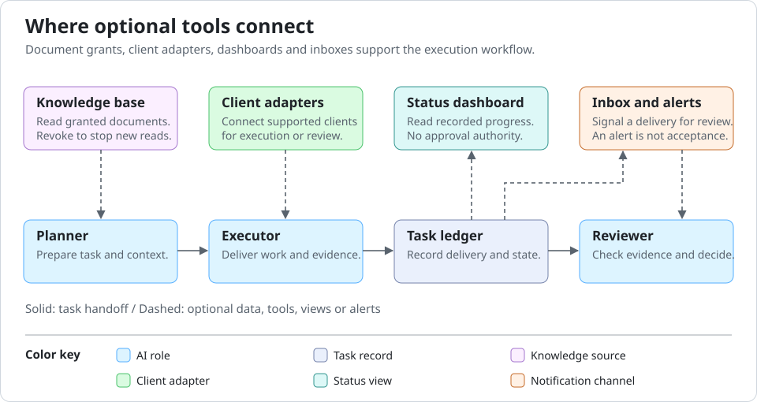

# Agent Workflow Orchestrator

AWO runs on its own. If you want a secretary interface, AWO v1.1.1 has also been tested with MAID v0.2.1.

English | [Chinese](README.zh-CN.md)

Let one AI agent plan and review while another does the work. You set the goal and define what is allowed; tasks move between agents through a local ledger, and **nothing counts as done until it has been independently reviewed**.

## Choose your starting point

- **Want one secretary to coordinate multiple projects?** Start with [MAID](https://github.com/cgy0071/MAID#readme). Pick a secretary, bind your Git repo, inspect the task draft, and confirm before dispatch. For that integration, follow MAID's setup instructions.
- **Want to manage the Planner, workers, and reviews directly?** Stay here. Run the 1-minute offline demo below first, then hand a real task in your project to the Planner. AWO works on its own without MAID.

## Let your AI set this up

Copy this prompt into your assistant (for example, Codex, Claude Code, agy or Cursor):

```text
Check the paths and versions of Git and Python (3.10+). List installed clients by path or version without starting a session. Report missing prerequisites instead of installing them.
Use my chosen setup directory; ask me for it if missing. Clone only into new subdirectories and never overwrite existing files.
Clone tag v1.1.1 from https://github.com/cgy0071/agent-workflow-orchestrator.git. MAID is not required. From the new checkout, use the checked Python for both commands. The first creates disposable demo state; the second only reads it:
python -B scripts/demo_scheduler.py --directory runtime/first-run
python -B scripts/workflow_control.py --state runtime/first-run/state status --summary --format text
Check for OFFLINE_DEMO_PASS and verify that A, B and JOIN are all accepted.
Do not modify my projects, access or change accounts or keys, make paid model calls, or dispatch real work. Report the environment, checkout paths, check results and the exact next command for me to run. Do not run that next step.
```

## Try it on Windows (no Git required)

**[Download AWO for Windows x64 (portable release candidate)](https://github.com/cgy0071/agent-workflow-orchestrator/releases/download/v1.0.0-rc.1/AWO-Windows-x64-rc-check.zip)** | [Release notes and checksum](https://github.com/cgy0071/agent-workflow-orchestrator/releases/tag/v1.0.0-rc.1)

Extract all files, then double-click the only `.cmd` file in the top folder. The offline demo runs two local workers and shows three accepted tasks: A, B, and JOIN. Open it again to see the saved result. Python is included; no account or API key is needed for the demo.

**[Install the Windows knowledge base plugin (0.4.1)](https://github.com/cgy0071/agent-workflow-orchestrator/releases/tag/kb-v0.4.1)** - Try a sample record with Python 3.10+ (including Anaconda).

**[Try the Windows host with task-scoped knowledge](https://github.com/cgy0071/agent-workflow-orchestrator/releases/tag/kb-host-v0.1.0-preview.1)** - Download the named Windows ZIP from the preview release (not GitHub's automatic Source code archive) and follow its three commands. The demo prints the project, revision, quote and `AWO KB HOST PREVIEW PASS`.

**[Download the Windows project commands 0.1.0](https://github.com/cgy0071/agent-workflow-orchestrator/releases/tag/project-cli-v0.1.0)** - Under Assets, download `AWO-Windows-Project-CLI-0.1.0.zip`, extract it, and run `python -B try_project.py` there with Python 3.10+.

[Project commands in this source checkout](docs/project-commands.md)

## 1-minute local demo (offline, no model cost)

Install **Git** and **Python 3.10+** first. This demo uses local simulated workers and makes no network or model calls. Pick the block for your shell (this installs AWO as a Codex Skill; for Claude Code, replace `.codex` with `.claude`; if you already cloned AWO, skip the clone and enter its directory):

Windows PowerShell:
```powershell
$awo = "$HOME/.codex/skills/agent-workflow-orchestrator"
git clone https://github.com/cgy0071/agent-workflow-orchestrator.git "$awo"
Set-Location "$awo"
python -B scripts/demo_scheduler.py --directory runtime/first-run
python -B scripts/workflow_control.py --state runtime/first-run/state status --summary --format text
```

macOS / Linux:
```sh
awo="$HOME/.codex/skills/agent-workflow-orchestrator"
git clone https://github.com/cgy0071/agent-workflow-orchestrator.git "$awo"
cd "$awo"
python3 -B scripts/demo_scheduler.py --directory runtime/first-run
python3 -B scripts/workflow_control.py --state runtime/first-run/state status --summary --format text
```

Seeing `OFFLINE_DEMO_PASS` means the simulation finished. Check that tasks `A`, `B`, and `JOIN` all show `accepted`. You can rerun just the `status` command with the same `--state` path anytime to inspect the result, or pick a fresh `--directory` for a new demo run.

## Start managing your project

1. **Open two sessions**: open your project in an authenticated **Planner** client (for planning and review), and start a separate **Executor** session (for coding and tests). They can use different AI tools (for example, Claude for Planner and Codex for Executor).
2. **Load AWO**: invoke `$agent-workflow-orchestrator` in Codex, or `/agent-workflow-orchestrator` in Claude Code.
3. **Give your first goal**: tell the Planner what to build, which files may be edited, and how to verify success. For example:

```text
In this repository, add pagination to /users. Limit edits to the endpoint and its tests.
Dispatch one task, monitor it and review its evidence. Stop after review; do not push.
```

4. **Stay in the loop**:
   - Check the proposed plan and window bindings before work starts;
   - If a worker asks for permission, answer it in **that worker's own window**;
   - Ask the Planner to open the read-only dashboard (or double-click `dashboard.cmd` / `dashboard.command`);
   - Before starting the next task, ask the Planner for the current status and review verdict.

## Supported features

The Windows ZIP runs the offline demo immediately. Real clients need configuration and authorization. To use an optional feature such as project knowledge, follow its setup guide for the project that needs it.

| Feature | What you can do | Access |
| --- | --- | --- |
| Offline demo | Run A and B with local workers, review JOIN and reopen saved results. | [Offline demo](references/manual-workflow.md) |
| Roles and review | Configure roles, inspect delivery evidence, then accept, request repair or reject. | [Setup](references/task-and-review.md) |
| Scheduling | Declare dependencies, dispatch independent work in parallel, and continue stalled tasks. | [Setup](references/scheduling.md) |
| Client adapters | Bind and switch workers; select command, receipt or optional Herdr transport based on verified client capabilities. | [Setup](references/harness-adapters.md) |
| Dashboard and alerts | Inspect progress and stalls, preview management actions, and send authorized notifications. | [Setup](references/monitoring.md) |
| External requests and remote access | Receive signed requests for review; optionally use a remote terminal from a phone. | [Setup](references/owner-intake.md) / [Details](references/remote-access.md) |
| Repository work | Prepare tasks in an existing repository, execute in isolated worktrees, review and land changes locally. | [Setup](references/project-entry.md) / [Details](references/worktree-code-loop.md) |
| Service and identity | Preview migrations, freeze writes, enroll agents, inspect capabilities and heartbeats, and revoke access. | [Enable for this project](references/awo-service.md) / [Details](references/awo-registry.md) |
| Budget and capacity | Reserve and reconcile usage; admit queued work by priority, available slots and resources. | [Enable for this project](references/awo-budget.md) / [Details](references/awo-scheduler.md) |
| Workspaces and merge queue | Assign an isolated directory or worktree, pin the baseline and land reviewed changes by ticket. | [Enable for this project](references/awo-workspaces.md) / [Details](references/awo-merge.md) |
| Messaging and collaboration | Send, reply to and acknowledge task messages; coordinate multiple workers with shared budgets and bounded repair. | [Enable for this project](references/awo-messaging.md) / [Details](references/awo-collaboration.md) |
| Project knowledge and documents | List authorized entries and read content, sources, revisions and review history by ID; check usability before reuse. | [Install the plugin](https://github.com/cgy0071/agent-workflow-orchestrator/releases/tag/kb-v0.4.1) / [Service API](references/awo-knowledge.md) |
| Application integrations | Call enabled service tools over MCP stdio, HTTP or WebSocket. | [Enable for this project](references/awo-gateway.md) |
| Supervision and audit | Inspect local advice and paired drafts, view project runs and export audit receipts. | [Enable for this project](references/awo-supervision.md) / [Details](references/awo-observability.md) |

## How it works




Grant access to a specific published document when a task needs it. Preparation checks the grant again; revoking it blocks future reads but does not erase copies already delivered. Adapters connect roles to supported clients. The dashboard shows recorded progress; an inbox event tells the reviewer when to act. Neither the dashboard nor a notification accepts work.

1. The **Planner** writes a clear task spec and sends it once to the **Executor**.
2. A **background monitor script** checks status via local receipts without asking a model to reread the conversation, so watching costs almost nothing.
3. Once the **Executor** delivers the expected outputs and evidence, the **Reviewer** gets one notification and decides: **accept**, **repair**, or **reject**.
4. With your approval, the next task begins. Without it, the system stops and reports back to you.

> Roles are decoupled from clients: mix Codex, Claude, or other supported harnesses as you like. The core rules (send once, review before done, one controller at a time) are enforced by the Python scripts in `scripts/`, not by prompts alone. Client support is verified per version; see [harness-adapters.md](references/harness-adapters.md).


## Next step: first real model run

If you want to verify a real end-to-end loop (requires Python 3.10+ and an authenticated Codex CLI), run from the repository root with a fresh directory each time:

```powershell
Remove-Item Env:HERDR_ENV -ErrorAction SilentlyContinue
python -B scripts/validate_v2_native_loop.py --directory runtime/repro/native-oneshot-1 --harness codex --mode one-shot --timeout 240
```

A pass prints `V2_NATIVE_LOOP_PASS` and exits 0. It makes three real model turns to verify your local CLI, one-shot sessions, dependency gating, and independent review on a directory-artifact task (it does not test Herdr panes or Git worktree code tasks). See the [first-real-run guide](references/first-real-run.md) and [worktree code loop](references/worktree-code-loop.md) for more options.

## Safety in short

- **Configuration is not permission.** Writing a config file never authorizes dispatch, notifications, or continuous runs; your explicit approval is required.
- **Done means reviewed.** An idle window or a zero exit code is never acceptance, and acceptance does not automatically merge or push code.
- **Each task is sent once.** Uncertain deliveries are logged for inspection, never blindly retried, and permission prompts are never auto-approved.
- **One controller, no self-review.** Switching controllers revokes the previous window; an Executor can never approve its own work.
- **Outside requests are data.** Requests from chat bots or external channels cannot start work without your direct approval.

> Every test certifies only what it actually ran (directory-artifact checks do not certify Git worktrees; priority and budget ledgers gate admission and settlement without killing an active model call).

## Optional extras

- **Dashboard management console** (`dashboard.py --allow-manage`): preview and confirm actions one by one (confirm starts, continue a stalled worker once, close tasks, adjust limits, assign windows).
- **Alerts to you** (`owner_notify.py`): push permission prompts, worker questions, failures, or long waits via file, webhook, or command.
- **Requests from you** (`owner_intake.py`): accept signed requests from chat channels into an inbox; the Planner only receives a request ID until you approve dispatch.

## Documentation

### Beginner essentials (start here)

| Topic | Guide |
|---|---|
| Project entry for an existing repository: prepare, run, independent review, local landing, recovery | [project-entry.md](references/project-entry.md) |
| Setup, bindings, switching windows, recovery | [setup-and-switching.md](references/setup-and-switching.md) |
| First real run: native one-shot, session resume, optional Herdr route, limits | [first-real-run.md](references/first-real-run.md) |
| Monitoring, dashboard, alerts, Owner intake | [monitoring.md](references/monitoring.md) |
| Roles, task and review templates, task states | [roles.md](references/roles.md), [task-and-review.md](references/task-and-review.md), [task-state-machine.md](references/task-state-machine.md) |

### Advanced / V2 subsystem references

| Topic | Guide |
|---|---|
| Doing every step by hand; concepts, config files, full safety model, repository layout | [manual-workflow.md](references/manual-workflow.md) |
| Dispatch, parallel task plans, continuation | [scheduling.md](references/scheduling.md) |
| Client adapters (Herdr, command, receipt) | [harness-adapters.md](references/harness-adapters.md) |
| Optional remote command line from a phone (Windows, SSH over Tailscale) | [remote-access.md](references/remote-access.md) |
| Channel contract for Owner requests | [owner-intake.md](references/owner-intake.md) |
| Opt-in V2 service boundary: additive schema, dry-run migration, freeze/epoch | [awo-service.md](references/awo-service.md) |
| Agent registry: enrollment grants, capability evidence, heartbeat, revocation | [awo-registry.md](references/awo-registry.md) |
| Budget ledger: scoped reservations, usage/exposure, authoritative close | [awo-budget.md](references/awo-budget.md) |
| Priority scheduler: queue order, collaboration slots, holds, admission gates | [awo-scheduler.md](references/awo-scheduler.md) |
| Assignment workspaces: isolated roots, Git worktrees, frozen source | [awo-workspaces.md](references/awo-workspaces.md) |
| Durable agent messaging: task/run scoped inbox, reply, acknowledgement | [awo-messaging.md](references/awo-messaging.md) |
| Local knowledge and documents: scoped registration and retrieval | [awo-knowledge.md](references/awo-knowledge.md) |
| Gateway and application transports: handlers, routing, replay rules | [awo-gateway.md](references/awo-gateway.md) |
| Collaboration runtime: fanout, ensemble, shared budget, bounded repair | [awo-collaboration.md](references/awo-collaboration.md) |
| Merge queue: accepted bases, materialization gate, ticket-bound intents | [awo-merge.md](references/awo-merge.md) |
| End-to-end Git worktree code loop: real worktree execution, independent review, local Merge Queue, materialization | [worktree-code-loop.md](references/worktree-code-loop.md) |
| Local supervision and paired external drafts (local label protocol, not certified A2A) | [awo-supervision.md](references/awo-supervision.md) |
| Read-only runtime views and isolated audit receipts | [awo-observability.md](references/awo-observability.md) |
| What changed and when | [CHANGELOG.md](CHANGELOG.md) |

---

The public Windows portable orchestrator candidate is linked above. The November 19 Native Agent Framework archive was a separate internal test artifact.

Application clients can query protocol 1 with `python -B scripts/awo_app.py capabilities`. See the [application protocol](docs/application-protocol.md) for preparing, starting, querying and recovering an individual run.

## License

AWO is available under the [MIT License](LICENSE).

[Secretary reporting guidance (Chinese)](docs/secretary-reporting.zh-CN.md) | [Windows troubleshooting (Chinese)](docs/troubleshooting-windows.zh-CN.md)
