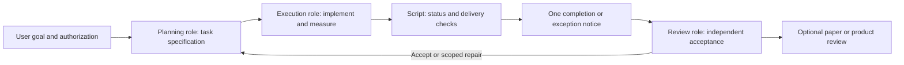

# Agent Workflow Orchestrator

English | [Chinese](README.zh-CN.md)

A configurable multi-agent Skill for **planning -> execution -> status monitoring -> completion notification -> independent review -> authorized follow-up**.

The workflow is independent of project files, models, and clients. Planner, Executor, and Paper Lead are defaults that can be replaced for software, product, or research work.

## Features

- **Editable roles:** change role names, count, responsibilities, permissions, and deliverables.
- **Editable architecture rules:** define project constraints, allowed changes, and admission stages in configuration.
- **Harness-independent roles:** any role can use Codex, Pi, Claude, dsh-tui, Grok, or another tool.
- **Configurable automation:** choose polling intervals, timeouts, completion criteria, reviewer, follow-up actions, and stop conditions.
- **Low-cost monitoring:** query status while work runs instead of repeatedly asking a model to read conversations.
- **Reviewer notification:** verify task identity and delivery, then send one message so the reviewer can continue an authorized plan.
- **Duplicate protection:** use unique task IDs/nonces, fresh completion sequences, monitor locks, and notification-attempt records.
- **Independent acceptance:** review_ready means delivery is ready for review, not that the task or design passed.
- **English defaults:** the Skill entry point, UI metadata, and English documentation are ASCII-only; Chinese translations remain available.

## Default roles

| Role | Responsibilities | Typical output |
|---|---|---|
| Planner / Engineering Lead | Analysis, design, task decomposition, evidence review, next decisions | Plans, tasks, reviews, decisions |
| Executor | Implementation, experiments, tests, measurement, first-difference diagnosis | RESULT / EVIDENCE / HANDOFF, changes, logs |
| Paper Lead | Research problem, literature gap, novelty, argument, experimental sufficiency | Claim-evidence analysis, evidence requests, manuscripts |

These are templates. Remove Paper Lead, add Reviewer, or combine planning with implementation while retaining independent acceptance. Roles are separate from harnesses.



## Installation

Requires Python **3.10+**. The scripts use only the standard library. Live integration also requires a verified automation interface for the selected client. Herdr is optional.

### Codex Skill

Clone this public repository into your Skill directory:

```powershell
git clone https://github.com/cgy0071/agent-workflow-orchestrator.git "$HOME/.codex/skills/agent-workflow-orchestrator"
```

Use your client's actual Skill directory if different. Refresh or reopen the session, then invoke:

```text
Use $agent-workflow-orchestrator.
Read workflow.json and follow its roles and stages for the current goal.
You may dispatch, monitor, review, and continue tasks within the authorized scope.
```

### Pi / Claude / dsh-tui / Grok

Load SKILL.md through the client's supported Skill/context mechanism, or provide it as workflow instructions together with the configuration path. Discovery directories and CLI flags depend on the installed client version. This repository does not change client configuration, authentication, or model settings.

## Quick start

### 1. Configure roles and workflow

Copy and edit [examples/workflow.json](examples/workflow.json):

```json
{
  "roles": {
    "planner": {"harness": "claude", "responsibilities": ["plan", "review"]},
    "executor": {"harness": "codex", "responsibilities": ["implement", "measure"]},
    "paper-lead": {"harness": "pi", "responsibilities": ["research", "write"]}
  },
  "architecture": {"constraints": ["retain public interfaces"]},
  "workflow": {
    "reviewer_role": "planner",
    "transitions": {"accept": "next_task_within_authorization", "repair": "new_scoped_repair_task"}
  },
  "automation": {"continuous_execution_authorized": true, "interval_seconds": 300}
}
```

Agents read this as workflow guidance. Configuration does not grant user permission. The monitor consumes a separate per-task request.json; it does not execute the entire workflow graph itself.

### 2. Specify and dispatch a task

Use [task-and-review.md](references/task-and-review.md) to define the objective, directory, scope, inputs, acceptance, delivery, and stop conditions. Discover and verify the Worker, check active tasks and directory ownership, record the submission attempt, and submit once. Reuse an existing scheduler and shared ledger when available.

Planner need not run in Codex, and Executor need not run in Pi. Record nicknames, models, and actual clients separately. Grok, for example, may be a standalone harness or a model inside Pi.

### 3. Configure a monitoring request

Copy [examples/request.herdr.json](examples/request.herdr.json) into a **new task directory**. Fill in the real session, identity, completion sequence, artifacts, and authorization. Replace placeholders and set dispatch_confirmed to true only after execution is confirmed.

| Worker adapter | Status source | Use case |
|---|---|---|
| herdr | Native agent get/read | Sessions that Herdr can identify reliably |
| command | Verified command returning canonical JSON | An official CLI/API bridge |
| receipt | Task-bound job status files | A harness with verified one-shot noninteractive execution |

Reviewers support herdr or command notification with identity checks. See [harness-adapters.md](references/harness-adapters.md) and [monitoring.md](references/monitoring.md) for the complete contract.

### 4. Start monitoring

```sh
python scripts/monitor_task.py --request /absolute/task/request.json --check
python scripts/monitor_task.py --request /absolute/task/request.json --notify
```

--check validates the local request without contacting agents. --notify also requires authorization.notify_reviewer set to true and a nonempty authorization source. See [monitoring.md](references/monitoring.md) for background startup.

The default polling interval is **300 seconds**. Overall monitoring continues until completion or an exception unless a limit is configured. There is no default one-hour cap; each external command still has a finite timeout.

### 5. Review and continue

After fresh completion and valid delivery, the monitor records artifact hashes and sends one notice to the verified reviewer. The reviewer reads the frozen request, changes, and raw evidence, records a decision, and creates the next authorized task or scoped repair. Follow-ups use a new ID/nonce. A notification is not new user authorization.

Missing delivery, blocked states, changed identities, failures, and uncertain notification are separate outcomes. An idle terminal or a zero exit code does not establish task acceptance.

## One-shot CLI jobs

Without Herdr, supply a verified one-shot command using [examples/job.json](examples/job.json):

```sh
python scripts/run_job.py --job /absolute/job.json
```

The runner uses an argument array and records status, the real exit code, and output.log for the receipt adapter. It does not guess provider arguments or treat an interactive TUI as a one-shot job. A TUI without reliable lifecycle events needs a verified bridge; until then, report ADAPTER_NOT_VERIFIED.

## Configuration layers

| Layer | Editable content | Consumer |
|---|---|---|
| workflow.json | Roles, architecture, stages, transitions, authorization scope | Collaborating agents |
| task.md | Objective, directory, inputs, acceptance, stop conditions | Executor and reviewer |
| request.json | Live identities, adapters, delivery checks, polling, notification | Monitor script |

Workers cannot expand their authorization by replacing task identities or configuration. Keep credentials out of tasks, argv, and the repository. STOP_MONITOR stops only monitoring; cancel actual work through the authorized scheduler.

## Languages and encoding

- English defaults: README.md, SKILL.md, agents/openai.yaml, and references/*.md without the zh-CN suffix. These files use ASCII characters only and remain valid UTF-8.
- Chinese translations: README.zh-CN.md, SKILL.zh-CN.md, and references/*.zh-CN.md. They use UTF-8 without BOM.
- English and Chinese documents have language-switch links. Examples and runtime scripts are shared.
- Git normalizes text to LF. Encoding checks detect invalid UTF-8, replacement characters, lossy question-mark sequences, common mojibake, and unexpected non-ASCII in English entry points.

If changing documentation languages, adjust the checker using --expect-cjk and --expect-ascii. An empty option list disables that specific language check.

## Tests and verified scope

```sh
python scripts/test_monitor.py
python scripts/check_encoding.py
```

Offline tests cover the five harness labels, no conversation reads while working, stale completion rejection, changed identity, missing/empty delivery, wrong nonce, missing marker, blocked/failed states, path escape, notification deduplication, uncertain delivery, and a real local child-process/receipt/monitor chain. Tests contact no live agents and send no real notifications.

These tests validate contracts and automation behavior, not live integration with every client version. Verify the actual client's identity, status, and precise session-delivery interface at first use. Reuse already verified adapters.

## Files

```text
SKILL.md / SKILL.zh-CN.md          Skill instructions
README.md / README.zh-CN.md        Setup and usage
agents/openai.yaml                English Skill UI metadata
references/                       English contracts and Chinese translations
examples/                         Editable workflow and request examples
scripts/monitor_task.py            Status checks and one-time notification
scripts/run_job.py                 One-shot CLI job receipts
scripts/test_monitor.py            Offline behavioral tests
scripts/check_encoding.py          UTF-8 and language integrity checks
```
