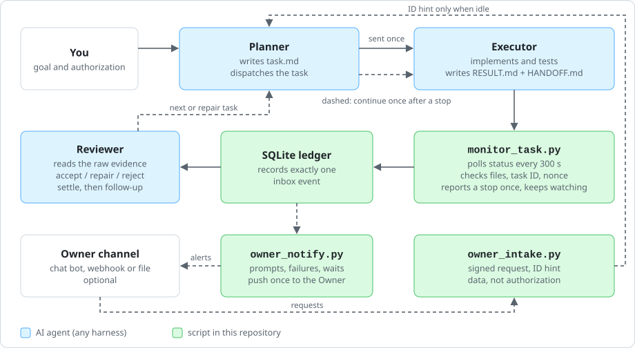
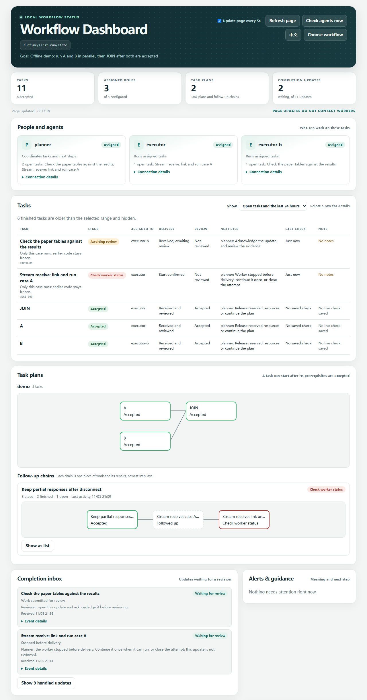

# Agent Workflow Orchestrator

English | [Chinese](README.zh-CN.md)

Let one AI agent plan and review while another does the work. You set the goal and say what is allowed; the agents hand tasks to each other through a local ledger, and nothing counts as done until it is reviewed.



## How it works

1. The **Planner** writes a task and sends it once to the **Executor**.
2. A background script checks the Executor's status. It never asks a model to reread the conversation, so watching costs almost nothing.
3. When the expected files are delivered, the **Reviewer** gets one update, reads the evidence and decides: accept, repair or reject.
4. With your permission, the next task follows. Without it, the agents stop and report to you.

Roles are not tied to a client: the Planner can run in Codex and the Executor in Claude, or another supported mix. Support is verified per client version, not inferred from a harness name; see [harness-adapters.md](references/harness-adapters.md). The rules (send once, review before done, one controller at a time) are enforced by the scripts in `scripts/`, not by prompts. `SKILL.md` teaches the controlling agent when to run them.

## Get started

1. **Install.** Clone the repository into your client's Skill folder:

   ```sh
   git clone https://github.com/cgy0071/agent-workflow-orchestrator.git "$HOME/.codex/skills/agent-workflow-orchestrator"   # Codex
   git clone https://github.com/cgy0071/agent-workflow-orchestrator.git "$HOME/.claude/skills/agent-workflow-orchestrator"  # Claude Code
   ```

   Other clients (Pi, dsh-tui, Grok, ...) load `SKILL.md` through their own Skill or context mechanism.

2. **Open one window per role** and start each client, for example Claude for the Planner and Codex for the Executor.

3. **Tell the Planner what to do.** In Codex use `$agent-workflow-orchestrator`, in Claude Code `/agent-workflow-orchestrator`, then give a goal and a scope:

   ```text
   Set up a Planner/Executor workflow for: add pagination to the /users endpoint.
   You may dispatch, monitor and review within this goal. Ask me before anything else.
   ```

   The agent creates the workflow config, binds the windows, writes the task, dispatches it and watches it. It asks you when it needs a decision.

4. **Watch and decide.** Ask the agent to "open the dashboard", or double-click `dashboard.cmd` (Windows) / `dashboard.command` (macOS). It shows open tasks, updates waiting for review and alerts. It is read-only unless started with action options.



What stays with you: the goal and how far the agents may go, approval prompts in each agent's own window, and any review you have not delegated. To run every step by hand instead, see the [manual walkthrough](references/manual-workflow.md).

## First real run

Needs Python 3.10+ and an installed, authenticated Codex CLI. Run from the repository root, with a new directory for each run. This makes three real model turns on a disposable fixture and stops if any review gate fails:

```powershell
Remove-Item Env:HERDR_ENV -ErrorAction SilentlyContinue
python -B scripts/validate_v2_native_loop.py --directory runtime/repro/native-oneshot-1 --harness codex --mode one-shot --timeout 240
```

A pass prints `V2_NATIVE_LOOP_PASS` and exits 0. It proves the installed client, one-shot sessions, dependency gating and independent review on a directory-artifact task. It does not prove Herdr, steering or restart recovery, cost, provider/model identity, or worktree/code-task behavior. The [first-real-run guide](references/first-real-run.md) also covers session resume and the optional Herdr pane route. Git worktree and code-task behavior are covered separately by the [worktree code loop](references/worktree-code-loop.md).

## Offline demo (mechanics only)

Needs Python 3.10+, no agent account or network. Run from the repository root, with a new directory for each run:

```sh
python -B scripts/demo_scheduler.py --directory runtime/first-run
python -B scripts/workflow_control.py --state runtime/first-run/state status --summary --format text
```

Tasks A and B run in parallel on two fake workers; JOIN starts only after both are reviewed and accepted. The first command prints `OFFLINE_DEMO_PASS`, and the status shows all three as `accepted`. This proves local DAG, dependency and review mechanics with Python child processes, not Harness compatibility.

## Safety in short

- **Configuration is not permission.** Dispatch, notification and continuous running each need your explicit approval.
- **Done means reviewed.** An idle window or a zero exit code is never acceptance, and acceptance is not landing.
- **Each task is sent once.** An uncertain send is recorded for inspection, never retried blindly. Approval prompts are never answered automatically.
- **One controller, no self-review.** An old window loses authority after a switch; a worker cannot review its own task.
- **Outside requests are data.** A request from a chat channel cannot start work without your direct approval.

A pass certifies only what it ran. Directory-artifact validation does not certify Git worktrees or code tasks; priority is not live steering; budget admission and settlement do not stop a call in progress; legacy knowledge origin can remain unknown.

## Optional extras

- **Dashboard management console** (`--allow-manage`): confirm starts, continue a stalled worker once, close tasks, change limits, assign windows, and see statistics. Every action is previewed, then confirmed once.
- **Alerts to you** (`owner_notify.py`): permission prompts, worker questions, failures and long waits, by file, webhook or command.
- **Requests from you** (`owner_intake.py`): a chat bot or other channel drops signed requests into an inbox; the Planner gets only a request ID.

## Documentation

| Topic | Guide |
|---|---|
| Doing every step by hand; concepts, config files, full safety model, repository layout | [manual-workflow.md](references/manual-workflow.md) |
| Setup, bindings, switching windows, recovery | [setup-and-switching.md](references/setup-and-switching.md) |
| First real run: native one-shot, session resume, optional Herdr route, limits | [first-real-run.md](references/first-real-run.md) |
| Monitoring, dashboard, alerts, Owner intake | [monitoring.md](references/monitoring.md) |
| Dispatch, parallel task plans, continuation | [scheduling.md](references/scheduling.md) |
| Client adapters (Herdr, command, receipt) | [harness-adapters.md](references/harness-adapters.md) |
| Roles, task and review templates, task states | [roles.md](references/roles.md), [task-and-review.md](references/task-and-review.md), [task-state-machine.md](references/task-state-machine.md) |
| Optional remote command line from a phone (Windows, SSH over Tailscale) | [remote-access.md](references/remote-access.md) |
| Channel contract for Owner requests | [owner-intake.md](references/owner-intake.md) |
| Opt-in V2 service boundary: additive schema, dry-run migration, freeze/epoch | [awo-service.md](references/awo-service.md) |
| Agent registry: enrollment grants, capability evidence, heartbeat, revocation | [awo-registry.md](references/awo-registry.md) |
| Budget ledger: scoped reservations, usage/exposure, authoritative close | [awo-budget.md](references/awo-budget.md) |
| Priority scheduler: queue order, collaboration slots, holds, admission gates | [awo-scheduler.md](references/awo-scheduler.md) |
| Assignment workspaces: isolated roots, Git worktrees, frozen source | [awo-workspaces.md](references/awo-workspaces.md) |
| Durable agent messaging: task/run scoped inbox, reply, acknowledgement | [awo-messaging.md](references/awo-messaging.md) |
| Local knowledge and documents: scoped registration and retrieval | [awo-knowledge.md](references/awo-knowledge.md) |
| Gateway and application transports: handlers, routing, replay rules | [awo-gateway.md](references/awo-gateway.md) |
| Collaboration runtime: fanout, ensemble, shared budget, bounded repair | [awo-collaboration.md](references/awo-collaboration.md) |
| Merge queue: accepted bases, materialization gate, ticket-bound intents | [awo-merge.md](references/awo-merge.md) |
| End-to-end Git worktree code loop: real worktree execution, independent review, local Merge Queue, materialization | [worktree-code-loop.md](references/worktree-code-loop.md) |
| Local supervision and paired external drafts (local label protocol, not certified A2A) | [awo-supervision.md](references/awo-supervision.md) |
| Read-only runtime views and isolated audit receipts | [awo-observability.md](references/awo-observability.md) |
| What changed and when | [CHANGELOG.md](CHANGELOG.md) |

English entry points are ASCII-only; Chinese translations live in `*.zh-CN.md` and are updated together.
