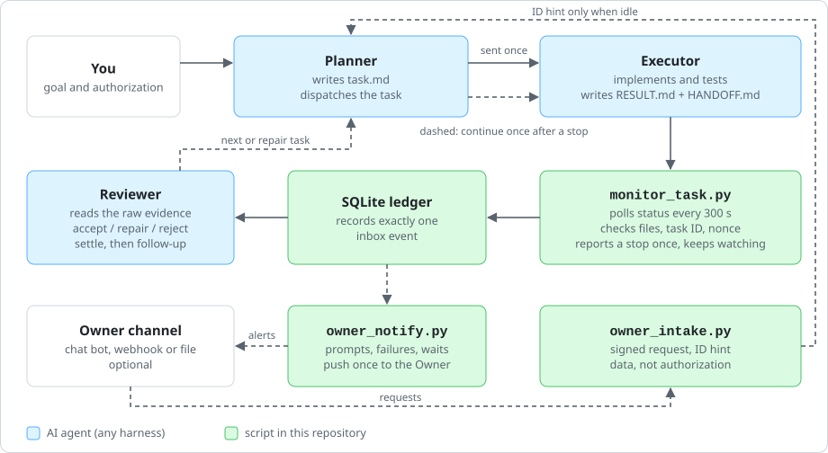

# Agent Workflow Orchestrator (AWO)

English | [Chinese](README.zh-CN.md)

AWO coordinates work between AI agents. You set the goal and scope. A Planner assigns the work, an Executor delivers it, and an independent Reviewer checks the evidence. A local ledger records each step. AWO works on its own or with an optional secretary such as MAID.

## How it works

The Planner sends each task once. A monitor reports delivery; the Reviewer accepts it, requests repairs or rejects it. Independent tasks can run in parallel, while dependent steps wait for acceptance.

## Capabilities and safeguards

Adapters connect different clients; the dashboard shows status and the inbox delivers alerts. Topic search returns cited project material after checking access; revocation blocks later reads. Configuration does not authorize dispatch, approval prompts stay with you, and workers cannot review their own tasks.

## Let your AI set this up

~~~text
Help me set up Agent Workflow Orchestrator (AWO) using docs/setup.md in the agent-workflow-orchestrator repository. Check Git, Python 3.10+ and installed clients. Ask for a destination; use the documented release in a fresh subdirectory. Run only the demo_scheduler.py and workflow_control.py status checks using new disposable demo state. Do not modify my projects, accounts or keys, make paid calls, or dispatch work. Report results and the next command, then stop.
~~~

## Guides

[Manual setup and documentation index](docs/setup.md) | [Material search and glossaries](references/material-packets.md)
