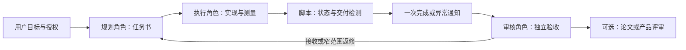

# Agent Workflow Orchestrator

[English](README.md) | Chinese

默认 README、Skill 入口、界面元数据和英文参考文档现为纯 ASCII 英文。中文版本以 `.zh-CN.md` 保存，配置示例和运行脚本由两种语言共用。

可配置的多角色 Agent 工作流 Skill：**任务规划 → 执行 → 脚本监控 → 完成通知 → 独立审核 → 继续派工**。

独立于具体工程、模型和客户端。默认提供 **Planner / Executor / Paper Lead**，也可替换为软件开发、产品交付、研究实验等角色组合。

## 功能

- **可改角色**：调整角色名称、数量、职责、权限及交付物，不将角色绑定到模型。
- **可改架构约束**：在配置中定义项目约束、允许的改动和准入阶段，不内置某个工程规则。
- **跨 harness**：任一角色可使用 Codex、Pi、Claude、dsh-tui、Grok 或其他工具。
- **可改自动化策略**：轮询间隔、超时、完成判据、审核者、审核后动作和停止条件均可配置。
- **低成本监控**：工作期间只查状态，不反复用模型读取完整对话。
- **完成后唤醒审核者**：核验身份、任务和交付，发送一次通知，由审核角色继续已有授权计划。
- **防重复**：唯一任务/nonce、新完成序列、监控锁和通知尝试记录；不把 idle 当成功，不盲目重发。
- **独立证据审核**：监控的 `review_ready` 只代表收到交付；是否通过由配置指定的角色判断。
- **身份绑定与交接**：选择实际会话、记录绑定版本、延后切换忙碌执行者，旧控制器自动失效。
- **持久化审核收件箱**：先保存完成事件，再尝试通知；确认收到和审核通过分别登记，REVIEW.md 与哈希绑定。
- **会话策略**：默认只写收件箱；真实分支元数据或用户声明的专用主窗口才允许直接通知。
- **持久派工与 DAG**：发送前记录尝试，约束目录／资源、并发数量、经过审核的依赖及汇合。
- **恢复与查询**：保存监控检查点、有限指数退避、补记完成事件及只读任务状态。

## 默认分工

| 角色 | 主要工作 | 默认交付 |
|---|---|---|
| Planner / Engineering Lead | 分析、设计、任务拆分、审核、后续决策 | 方案、任务书、审核和决策 |
| Executor | 实现、实验、测试、测量和首差定位 | RESULT / EVIDENCE / HANDOFF、变更和日志 |
| Paper Lead | 科学问题、相关工作、创新判断、论证和稿件 | claim–evidence、补证请求、论文稿 |

这些是模板，不是固定组织结构。可以删去 Paper Lead、加入 Reviewer，或合并规划与实现，同时保留独立验收。角色职责与使用哪个 harness 无关。



## 安装

需要 Python **3.10+**，脚本只用标准库。实际 Agent 接入还需要相应客户端及其已核验的自动化接口。Herdr 是可选项，不是角色协议的依赖。

### Codex Skill

将公开仓库克隆到 Skill 目录：

```powershell
gh repo clone cgy0071/agent-workflow-orchestrator "$HOME/.codex/skills/agent-workflow-orchestrator"
```

也可放到当前客户端实际使用的 Skill 目录。刷新/重新打开会话后调用：

```text
使用 $agent-workflow-orchestrator。
按 workflow.json 的角色和阶段推进当前目标。
允许在该目标及已给定范围内自动派工、监控、审核和继续执行。
```

### Pi / Claude / dsh-tui / Grok

通过该客户端支持的 Skill/上下文加载机制载入 `SKILL.md`，或将其作为会话工作流指令，并提供配置路径。各客户端的自动发现目录和 CLI 参数可能不同，以实际版本为准；此仓库不改动客户端配置、认证或模型设置。

## 快速使用

### 1. 配置角色与流程

复制并修改 [`examples/workflow.json`](examples/workflow.json)：

```json
{
  "roles": {
    "planner": {"harness": "claude", "responsibilities": ["plan", "review"]},
    "executor": {"harness": "codex", "responsibilities": ["implement", "measure"]},
    "paper-lead": {"harness": "pi", "responsibilities": ["research", "write"]}
  },
  "architecture": {"constraints": ["retain public interfaces"]},
  "workflow": {
    "reviewer_role": "planner",
    "transitions": {"accept": "next_task_within_authorization", "repair": "new_scoped_repair_task"}
  },
  "automation": {"continuous_execution_authorized": true, "interval_seconds": 300}
}
```

配置是给 Agent 读取的工作流规则；它不会自行产生用户授权。监控脚本读取的是下面每项任务独立的 request.json，而不是自动解释整个工作流图。

### 2. 选择实际 harness 和窗口

支持 **手动创建** 和 **自动创建** 两种方式：手动打开窗口或会话、进入工作目录并启动或选择 harness；或由已验证的控制器通过所选客户端支持的接口创建会话，以用户选定参数启动 harness。两种方式都先核验实际运行配置与会话身份，再绑定角色，后续共用监控和审核流程。已有可用会话也可核验后复用。自动创建需要已验证的启动接口，bind/preflight 本身不启动客户端。

本文中的 **pane 特指 Herdr 的终端分屏单元**。pane 创建命令是 Herdr 专用示例；其他客户端使用各自已验证的窗口或会话接口及标识。

完整操作见 [初始化、窗口选择与会话切换](references/setup-and-switching.zh-CN.md)，包括身份核验、初始化、绑定、切换、确认、审核和恢复命令。角色中的 `harness` 名称不会自动选择窗口，需要为每个角色保存实际核验的适配器配置。

```sh
python scripts/workflow_control.py --state /absolute/workflow-state init --config workflow.json
python scripts/workflow_control.py --state /absolute/workflow-state bind --role planner --spec planner.json --mode controller --policy inbox_only
python scripts/workflow_control.py --state /absolute/workflow-state bind --role executor --spec worker.json --mode worker
```

保存控制器返回的 instance/version。侧对话仅提供建议；客户端不提供真实对话和分支标识时，无法自动可靠识别，应使用收件箱或明确指定专用主窗口。context 是可信操作者/桥接器声明，不是身份认证。

### 3. 写任务并派发

按 [`references/task-and-review.zh-CN.md`](references/task-and-review.zh-CN.md) 写任务：目标、目录、允许改动、输入、验收、交付和停止点。发现并核验 Worker 的真实身份，检查当前任务/目录占用，保存投递记录后单次派发。若已有调度器和共享台账，复用它们。

Planner 不一定是 Codex，Executor 不一定是 Pi。昵称、模型与实际客户端分别记录；例如 Grok 可以是独立 harness，也可以是 Pi 中的模型。

### 4. 配置监控请求

从 [`examples/request.herdr.json`](examples/request.herdr.json) 复制到**新的任务目录**，填写实际 session、身份、完成序列、交付与授权。默认示例不能直接投递，必须替换占位值，并在确认执行已开始后设置 `dispatch_confirmed: true`。

监控支持三类 Worker：

| 适配 | 状态来源 | 使用场景 |
|---|---|---|
| `herdr` | 原生 agent get/read | Herdr 能准确识别的会话 |
| `command` | 经核验命令返回规范 JSON | 任意官方 CLI/API 外层适配 |
| `receipt` | 独立作业的任务绑定状态文件 | 任意支持单次非交互运行的 harness |

审核者支持 `herdr` 或 `command` 通知，发送前核验目标身份。完整合同见 [`harness-adapters.zh-CN.md`](references/harness-adapters.zh-CN.md) 和 [`monitoring.zh-CN.md`](references/monitoring.zh-CN.md)。

### 5. 开始监控

```sh
python scripts/monitor_task.py --request /absolute/task/request.json --check
python scripts/monitor_task.py --request /absolute/task/request.json --preflight
```

使用台账时，在请求中填写 `workflow_state`。确认派工开始后，先登记最终请求再监控：

```sh
python scripts/workflow_control.py --state /absolute/workflow-state register-task --request /absolute/task/request.json --actor CONTROLLER_INSTANCE --version 1 --context main
python scripts/monitor_task.py --request /absolute/task/request.json --notify
```

`--check` 只检查本地结构；`--preflight` 只读核对身份和派工前完成序号。`--notify` 需要 `authorization.notify_reviewer: true` 及授权来源；直接通知还需要相应会话策略，默认只保存待审核事件。后台启动示例见 [monitoring.zh-CN.md](references/monitoring.zh-CN.md)。

默认每 **300 秒**检查一次，整体持续到完成或异常；不要求模型持续盯着终端，也没有一小时总时限。每次外部命令都有有限超时。

### 6. 自动审核与续派

监控发现新完成及合格交付后，先保存哈希和事件，再按策略通知。已绑定的主审核会话确认事件、独立核查原始证据并登记 REVIEW.md；控制器执行 next-check，在新请求中引用返回的 parent_review。完整命令见初始化指南。新任务使用新 ID/nonce；通知本身不等于新用户授权。

缺交付、blocked、身份变化、执行失败和不确定通知会单独记录。终端空闲或命令退出 0 不等于任务通过。

## 持久派工与审核门控 DAG

[调度指南](references/scheduling.zh-CN.md)给出派工、执行核实、旧库迁移、资源配额及 DAG load/tick 命令。请求需要明确派工授权；每次 tick 有限执行一轮就绪调度，执行核实与审核仍需显式完成。真实客户端版本及原始证据按[能力合同](references/capabilities.zh-CN.md)记录。

```sh
python scripts/workflow_control.py --state /absolute/workflow-state status
python scripts/workflow_control.py --state /absolute/workflow-state inspect --task TASK-ID
python -B scripts/demo_scheduler.py --directory runtime/new-demo
```

演示以真实本地 Python 子进程作为测试 Worker，执行 A/B -> JOIN，并登记测试审核，不连接供应商。生产客户端兼容性仍需对应版本的实际接入证据。

## 单次 CLI 作业

如果不使用 Herdr，可按 [`examples/job.json`](examples/job.json) 提供经过确认的实际单次命令：

```sh
python scripts/run_job.py --job /absolute/job.json
```

脚本以参数数组启动命令，输出状态文件、真实返回码和 output.log；receipt 适配据此监控。它不猜测 Codex、Pi、Claude、dsh-tui 或 Grok 的参数，不用于无单次模式的交互 TUI。交互 TUI 需可靠的状态事件桥接，未验证前标 `ADAPTER_NOT_VERIFIED`。

## 配置分层

| 层 | 可改内容 | 谁读取 |
|---|---|---|
| workflow.json | 角色、职责、架构、阶段、转移、自动化授权范围 | 协作 Agent |
| task.md | 本项目标、目录、输入、验收与停止点 | 执行及审核角色 |
| request.json | 实际身份、适配命令、交付判据、轮询与通知 | 监控脚本 |

任务身份、会话目标与授权不能由 Worker 自行替换来扩大权限。不要把凭证放进任务、argv 或仓库。`STOP_MONITOR` 文件只停止监控；取消正在执行的工作须按调度器授权另行处理。

## 测试与已验证范围

```sh
python -B -m unittest discover -s scripts -p "test_*.py" -v
python scripts/check_encoding.py
```

离线测试覆盖五种 harness 标签、工作中不读对话、旧完成拒绝、身份变化、缺/空交付、错误 nonce、缺标记、blocked/失败、路径越界、通知去重、不确定通知不重试，以及真实本地子进程 → 回执 → 监控闭环。测试不会连接真实 Agent 或发送真实通知。

新增测试覆盖严格配置、有限只读重试、新完成独立宽限期、预检查、延后切换、旧控制器失效、声明为侧对话时拒绝操作、事件找回和审核哈希校验。CI 使用 Windows/Linux 和 Python 3.10/3.12。

编码检查会拒绝无效 UTF-8、替换字符、连续问号造成的有损文本和常见乱码；同时确认中文翻译仍包含中文，默认英文入口不含非 ASCII 字符。可用 `--expect-cjk` 和 `--expect-ascii` 调整或关闭对应语言检查。文本统一保存为 UTF-8、无 BOM，Git 使用 LF 换行。

这些结果验证接口合同与自动化行为，**不表示所有客户端版本都完成现场连接测试**。首次接入需核验当前工具版本的身份、状态与精确会话投递接口；既有可用适配可复用。

## 目录

```text
SKILL.md                    技能入口
agents/openai.yaml          Skill UI 元数据
references/                 角色、任务、适配与监控合同
examples/                   可修改的工作流与任务请求示例
scripts/monitor_task.py      状态检测与一次通知
scripts/workflow_control.py  绑定、收件箱、交接和审核门
scripts/workflow_scheduler.py 持久派工、DAG、占用与状态
scripts/demo_scheduler.py    可复现的本地子进程 DAG 演示
scripts/run_job.py           单次 CLI 作业回执
scripts/test_*.py            离线行为与集成验证
scripts/check_encoding.py    UTF-8 与有损文本检查
```
