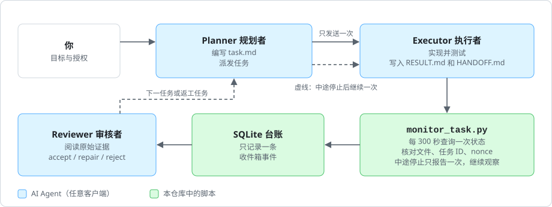
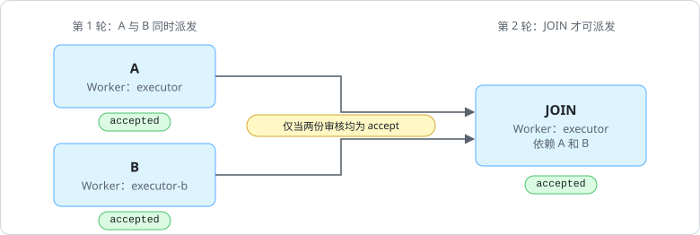
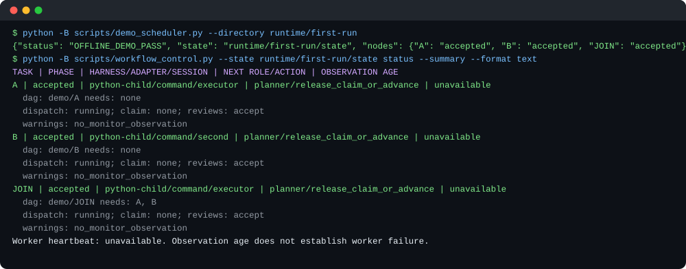
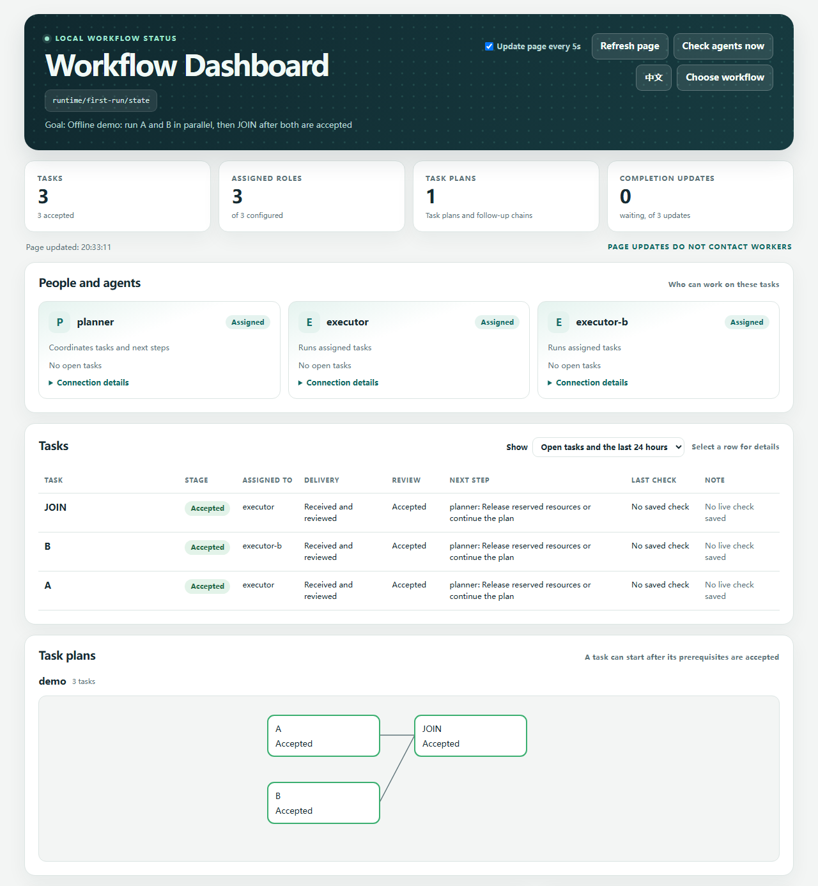
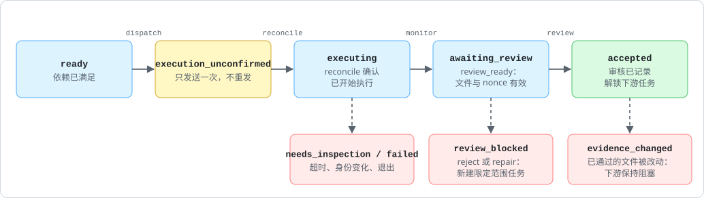

# Agent Workflow Orchestrator

[English](README.md) | Chinese

一个协调多个 AI 编程 Agent 的本地工具，并附带一个 Agent Skill，教控制者 Agent 如何使用它。一个 Agent 负责规划和审核，另一个负责实现；工具负责记录派发、监控状态和把关审核，你不必守在各个终端前。

## 解决什么问题？

没有这个工具时的典型情况：Claude 在一个窗口里做规划，Codex 在另一个窗口里写代码，你要来回切换、复制结果、判断任务是否“真的”完成，再决定下一步发什么。

使用本工具后：

1. **Planner** Agent 写好任务（目标、范围、验收标准），向 **Executor** Agent 只派发一次。
2. 脚本每 5 分钟查询一次 Executor 的*状态*。它不会让模型反复重读对话，所以监控几乎不消耗成本。
3. Executor 完成且约定的交付文件（如 `RESULT.md`、`HANDOFF.md`）通过校验后，脚本为审核者记录一次完成事件；直接发送提示是可选的。Executor 提前停止或停在提示上时，也会报告一次并继续观察。
4. 审核者检查原始证据，记录 `accept`、`repair` 或 `reject`；如果你已授权，再派发下一个任务。

仓库由两部分组成：

- **工具**（`scripts/`）：仅依赖标准库的 Python 命令，提供本地 SQLite 账本、派发、监控和审核关卡。“只发送一次、只通知一次、未审核不算完成、旧控制者失去权限”这些保证由工具强制执行，而不是靠提示词。
- **Skill**（`SKILL.md`）：Agent 加载的操作规程，告诉它何时运行这些命令、如何编写任务和审核、何时停止。工具通常由担任控制者的 Agent 运行，你也可以手动运行。



角色与工具无关。Planner 可以运行在 Codex 中，Executor 可以运行在 Claude 中，任意组合均可。

## 30 秒试用

需要 Python 3.10+，不需要 Agent 账号或网络。在仓库根目录执行：

```sh
python -B scripts/demo_scheduler.py --directory runtime/first-run
python -B scripts/workflow_control.py --state runtime/first-run/state status --summary --format text
```

演示会构建一个小型任务图：独立的任务 **A** 和 **B** 同时具备派发条件，交给两个模拟 Worker（本地 Python 子进程）；**JOIN** 要等两者都审核通过后才具备派发条件。



第一条命令输出 `OFFLINE_DEMO_PASS`；状态视图中 A、B、JOIN 均为 `accepted`，并列出每个任务的依赖、派工状态和审核结论。每次运行请使用新目录。



演示检查调度、单次派发、交付校验和审核关卡；它没有运行后台轮询循环、直接通知，也不能证明某个真实客户端（Codex、Claude 等）兼容。

## 核心概念

| 术语 | 含义 |
|---|---|
| 角色（Role） | 工作流中的一个职位，例如 Planner 或 Executor。名称、数量和权限均可修改。 |
| Harness | 实际运行某个角色的 Agent 客户端：Codex、Claude、Pi、dsh-tui、Grok 等。 |
| 适配器（Adapter） | 脚本与 harness 通信的方式：`herdr`、`command`（经核验的 CLI/API 桥接）或 `receipt`（一次性作业写出的状态文件）。 |
| Herdr | 可选的 Agent 会话终端复用工具。**pane** 指 Herdr 的一个终端分屏。不是必需的。 |
| 控制者（Controller） | 唯一持有派发权限的有效绑定，通常是 Planner；单独绑定的审核者也可登记审核。 |
| 绑定（Binding） | 经核验的“角色 X 就是这个会话”的记录。绑定有版本号，切换后旧版本失去权限。 |
| 状态目录 | 私有的 SQLite 账本，保存绑定、任务、事件和审核记录，由 `init` 创建。 |
| 任务 ID / nonce | 每个任务唯一的值，用来关联派发消息、请求和完成证据；过期结果会被拒绝。 |
| 完成序列 | Worker 报告的计数器。只有派发之后出现的递增才算新的完成。 |
| review_ready | 交付文件存在且有效，表示“可以审核”，不表示“已通过”。 |
| 收件箱（Inbox） | 完成事件等待处理的地方。默认不直接提示审核者，由审核者读取收件箱。 |

## 谁来执行哪一步？

| 步骤 | 通常由谁完成 |
|---|---|
| 编辑 `workflow.json`、给出授权 | 你 |
| 打开 Agent 窗口并启动客户端 | 你 |
| 在控制者 Agent 中加载 Skill | 你 |
| `init`、`bind`、编写任务、派发、审核命令 | 控制者 Agent 按 `SKILL.md` 执行（也可由你手动执行） |
| 轮询状态并记录一次完成事件 | 在后台运行的 `monitor_task.py` |

## 安装

一次克隆即可同时安装两部分：客户端读取 `SKILL.md`，控制者从同一目录运行 `scripts/`。工作流状态目录请放在克隆目录之外。把仓库克隆到客户端的 Skill 目录，例如：

```sh
# Codex
git clone https://github.com/cgy0071/agent-workflow-orchestrator.git "$HOME/.codex/skills/agent-workflow-orchestrator"
# Claude Code
git clone https://github.com/cgy0071/agent-workflow-orchestrator.git "$HOME/.claude/skills/agent-workflow-orchestrator"
```

其他客户端（Pi、dsh-tui、Grok 等）请通过各自的 Skill 或上下文机制加载 `SKILL.md`，或把它作为指令粘贴进去。Skill 目录和命令行参数取决于客户端版本。本仓库不会修改客户端配置、凭证或模型设置。

在 Codex 中让控制者 Agent 使用 `$agent-workflow-orchestrator`；在 Claude Code 中调用 `/agent-workflow-orchestrator`。随后提供目标、`workflow.json` 和你的授权范围。

```text
Read workflow.json and follow its roles and stages for the current goal.
You may dispatch, monitor, review, and continue tasks within the authorized scope.
```

## 第一个真实工作流：一个 Planner，一个 Executor

以下步骤展示操作顺序。请在仓库根目录运行命令，把所有 `/abs/...`、`INSTANCE`、`TASK-ID` 和 `EVENT_ID` 换成真实值；仓库外的文件使用绝对路径。完整命令和选项见[初始化、窗口选择与交接](references/setup-and-switching.zh-CN.md)。

### 1. 描述团队（`workflow.json`）

复制 [examples/workflow.json](examples/workflow.json)，修改角色、目标和自动化策略。不需要研究评审时删除 `paper-lead`。最小结构：

```sh
cp examples/workflow.json workflow.json
```

```json
{
  "goal": "Add pagination to the /users endpoint",
  "roles": {
    "planner": {"harness": "claude", "responsibilities": ["plan", "review"]},
    "executor": {"harness": "codex", "responsibilities": ["implement", "test"]}
  },
  "workflow": {"dispatch_role": "planner", "execution_role": "executor", "reviewer_role": "planner"},
  "automation": {"continuous_execution_authorized": false, "interval_seconds": 300}
}
```

`harness` 只是标签，不会打开或选择窗口。

### 2. 打开 Agent，并描述如何连接它们

为每个角色打开一个窗口/会话，启动客户端并选择模型。以下命令从示例请求中提取初始绑定规格；绑定前须把所有占位符改成核验过的真实身份和适配器配置：

```sh
python -B -c "import json; r=json.load(open('examples/request.herdr.json')); r['worker'].pop('baseline_completion_seq'); json.dump(r['worker'],open('worker.json','w')); json.dump(r['reviewer'],open('planner.json','w'))"
```

`worker.json` 来自 `worker`，`planner.json` 来自 `reviewer`。示例使用可选的 Herdr；如果有经核验的原生命令桥接，应优先使用。字段和一次性作业的回执方案见 [harness-adapters.zh-CN.md](references/harness-adapters.zh-CN.md)。回执 Worker 不能接受调度器派发；应按文档使用运行器启动作业。

### 3. 创建状态并绑定角色

```sh
python scripts/workflow_control.py --state /abs/state init --config workflow.json
python scripts/workflow_control.py --state /abs/state bind --role planner --spec planner.json --mode controller --policy inbox_only
python scripts/workflow_control.py --state /abs/state bind --role executor --spec worker.json --mode worker
```

`bind` 会查询实时会话，身份不符时拒绝绑定。请保存它输出的控制者 `instance_id` 和 `version`，后续命令通过 `--actor` 和 `--version` 传入。使用 Herdr 时，绑定的 pane 还会被命名为 `awo:<角色>`，方便分辨哪个窗格是哪个角色；你自己起的名字会保留。`workflow_control.py --state /abs/state roles` 显示每个角色对应的窗格，以及身份是否仍一致。

### 4. 编写任务及其请求

先在新的任务目录中建立请求：

```sh
python -B -c "from pathlib import Path; Path('/abs/task').mkdir(parents=True, exist_ok=False)"
cp examples/request.herdr.json /abs/task/request.json
```

- `task.md`：Executor 要做什么，须包含准确的任务 ID 和 nonce。模板见 [task-and-review.zh-CN.md](references/task-and-review.zh-CN.md)。
- `request.json`：监控脚本要检查什么。把示例中的 `worker` 和 `reviewer` 对象替换为已绑定的规格，并加入 Worker 实测的 `baseline_completion_seq`。设置唯一的 `task_id` 和 `nonce`、实际的 `cwd`、预期交付文件和标记，让 `workflow_state` 指向状态目录。在对账前保持 `dispatch_confirmed: false`。

先在不联系任何 Agent 的情况下校验，再做只读身份检查：

```sh
python scripts/monitor_task.py --request /abs/task/request.json --check
python scripts/monitor_task.py --request /abs/task/request.json --preflight
```

### 5. 只派发一次

把 `authorization.dispatch_worker` 设为 `true`，填写真实的授权来源 `source`。仅在允许审核者策略下直接发消息时才把 `authorization.notify_reviewer` 设为 `true`。确保 `task.md` 与 `request.json` 中的任务 ID 和 nonce 一致，然后执行：

```sh
python scripts/workflow_scheduler.py --state /abs/state dispatch --request /abs/task/request.json --message-file task.md --actor INSTANCE --version 1 --context main
```

确认 Executor 确实已开始执行后，编写 `EXECUTION.md`（任务 ID、nonce、`Outcome: running` 以及你观察到的情况），再生成已确认的请求：

```sh
python scripts/workflow_scheduler.py --state /abs/state reconcile --task TASK-ID --outcome running --evidence /abs/task/EXECUTION.md --request-out /abs/task/confirmed.json --actor INSTANCE --version 1 --context main
```

如果任务是通过其他接口发送的，请按设置指南使用 `register-task`。详见 [scheduling.zh-CN.md](references/scheduling.zh-CN.md)。

### 6. 监控

```sh
python scripts/monitor_task.py --request /abs/task/confirmed.json --notify
```

监控默认每 300 秒轮询一次，直到完成或出现异常为止。默认没有总时长上限，但每次状态查询都有超时。设置了 `workflow_state` 后，即使 `authorization.notify_reviewer` 为 false，`--notify` 仍会记录收件箱事件；在 `inbox_only` 策略下绝不直接提示审核者。后台启动方式和完整的状态约定见 [monitoring.zh-CN.md](references/monitoring.zh-CN.md)。

如果 Executor 提前停止（额度、限流、网络）或停在权限提示上，监控只报告一次，然后继续观察同一个任务，之后完成的交付仍会进入审核。未交付就停止时，控制者可以对同一任务发送一次受限的 `workflow_scheduler.py continue --task TASK-ID`，而不是重新派发。权限提示留给你在 Executor 自己的窗口中处理。详见 [scheduling.zh-CN.md](references/scheduling.zh-CN.md#中途停顿权限提示与受限继续)。

### 7. 审核并继续

```sh
python scripts/workflow_control.py --state /abs/state inbox
python scripts/workflow_control.py --state /abs/state ack --event EVENT_ID --actor INSTANCE --version 1 --context main
python scripts/workflow_control.py --state /abs/state review --event EVENT_ID --file /abs/task/REVIEW.md --verdict accept --actor INSTANCE --version 1 --context main
python scripts/workflow_control.py --state /abs/state next-check --event EVENT_ID --actor INSTANCE --version 1 --context main
```

审核者阅读原始证据，编写包含任务 ID、nonce 和结论的 `REVIEW.md`。`next-check` 返回一条 `parent_review` 记录，把它写入下一个任务的请求以关联后续任务。未授权 `continuous_execution_authorized` 时，控制者到此停止并向你汇报。

如需在本机查看台账，可打开可选状态面板。它只读台账、不联系 Agent，并把需要你处理的内容放在前面：进行中和最近的任务（较早已结束的任务按时间范围折叠）、以卡片显示的后续任务链、等待审核的更新，以及需要检查的提醒。任务标题取自各任务的 `TASK.md`，不显示 ID、哈希或路径。**立即检查 Agent** 只在点击时查询 Agent。界面可在中文和英文之间切换。以下任一方式都会在浏览器中打开面板：

- 在仓库文件夹中双击 `dashboard.cmd`（Windows）或 `dashboard.command`（macOS），再选择最近用过的状态目录或粘贴路径。
- 对控制者 Agent 说“打开状态面板”，Skill 已写明做法。
- 运行 `python -B scripts/dashboard.py`，可加 `--state /abs/state`。



操作功能默认关闭，需要在启动时开启：`--allow-dispatch` 开启表单派发和审核操作（派发后仍须独立观察执行并运行 `reconcile`），`--allow-chat` 让已绑定的控制者给任意有效角色发消息。要从手机或其他电脑打开，可使用 `--lan`（私有网络 HTTPS）、SSH 隧道，或配合 `--public-origin` 的私有 HTTPS 代理。带令牌的地址就代表这些操作权限，只交给可以使用它们的人。详见 [monitoring.zh-CN.md](references/monitoring.zh-CN.md)。

任何时候都可以用 `workflow_control.py --state /abs/state status --summary --format text` 查看各任务所处阶段和下一步动作。主要阶段如下：



## 配置文件一览

| 文件 | 内容 | 读取者 |
|---|---|---|
| `workflow.json` | 角色、架构约束、阶段、流转、自动化策略 | Agent（作为指引）和 `init` |
| `planner.json`、`worker.json` | 如何连接各角色的实时会话 | `bind` |
| `task.md` | 目标、目录、允许的改动、验收、停止条件 | Executor 和审核者 |
| `request.json` | 单个任务的身份、交付检查、轮询、通知 | 监控脚本和调度器 |

## 安全模型与限制

- **配置不等于授权。** 派发、通知和连续执行都需要你明确授权。通知本身也不构成新的授权。
- **完成以审核为准。** 终端空闲、退出码为 0 或 `review_ready` 都不算通过，只有登记的审核结论才算。
- **不盲目重试。** 每个任务只发送一次。发送或通知结果不确定时，会被记录下来留待检查。对中途停止任务的 `continue` 有次数限制、先记账，且不会重试。
- **暂停不等于结束。** Worker 提前停止或停在提示上时，监控继续进行；任务未关闭时不能审核暂停事件，审批提示从不自动回答。
- **只有一个控制者。** 切换后旧绑定失去权限。旁支对话可以提供建议，但不能确认事件、审核或派发。
- **停止监控不会停止 Worker。** 取消工作需要单独处理。
- **上下文标志是受信输入。** `--context main` 由操作者或桥接程序声明，不是身份认证。
- **不预设真实客户端兼容。** 首次使用某个真实客户端时，需核验其身份、状态和投递接口。无法核验时报告 `ADAPTER_NOT_VERIFIED`，不要猜测。
- 不要把凭证写入任务、命令参数或仓库。

## 更多指南

| 主题 | 指南 |
|---|---|
| 默认角色及如何修改 | [roles.zh-CN.md](references/roles.zh-CN.md) |
| 设置、绑定、会话策略、切换窗口、恢复 | [setup-and-switching.zh-CN.md](references/setup-and-switching.zh-CN.md) |
| 适配器约定（Herdr、command、receipt） | [harness-adapters.zh-CN.md](references/harness-adapters.zh-CN.md) |
| 可选 OMP 单次执行桥接 | [omp.zh-CN.md](references/omp.zh-CN.md) |
| 监控行为、结果类型、后台运行 | [monitoring.zh-CN.md](references/monitoring.zh-CN.md) |
| 单次派发、并行 DAG、资源占用 | [scheduling.zh-CN.md](references/scheduling.zh-CN.md) |
| 任务状态与事件 | [task-state-machine.zh-CN.md](references/task-state-machine.zh-CN.md) |
| 任务与审核模板 | [task-and-review.zh-CN.md](references/task-and-review.zh-CN.md) |
| 带版本的客户端能力证据 | [capabilities.zh-CN.md](references/capabilities.zh-CN.md) |

**不使用 Herdr 时：** 具备经核验的一次性（非交互）命令的客户端，可以通过 `scripts/run_job.py --job job.json` 运行（参见 [examples/job.json](examples/job.json)）。运行器会记录状态、真实退出码和 `output.log`，供 `receipt` 适配器使用。交互式 TUI 则需要经核验的桥接程序。

## 开发

英文入口文件（`README.md`、`SKILL.md`、`agents/openai.yaml`、`references/*.md`）必须为纯 ASCII。中文翻译放在 `*.zh-CN.md` 中，两种语言需同步更新。文本使用无 BOM 的 UTF-8 和 LF 换行。

## 仓库结构

```text
SKILL.md / SKILL.zh-CN.md          Agent 加载的指令
README.md / README.zh-CN.md        本指南
agents/openai.yaml                 Skill 界面元数据
references/                        详细指南与约定
examples/                          workflow.json、request.herdr.json、dag.json、job.json
docs/images/                       README 配图
scripts/workflow_control.py        状态、绑定、窗格名称、收件箱、审核关卡、状态查询
scripts/workflow_scheduler.py      派发、受限继续、DAG、资源占用
scripts/monitor_task.py            状态轮询、停顿报告与一次性通知
scripts/run_job.py                 带回执的一次性 CLI 作业
scripts/demo_scheduler.py          离线演示
scripts/dashboard.py               本地台账面板，可选派发、审核和对话
dashboard.cmd / dashboard.command  双击启动面板
```
