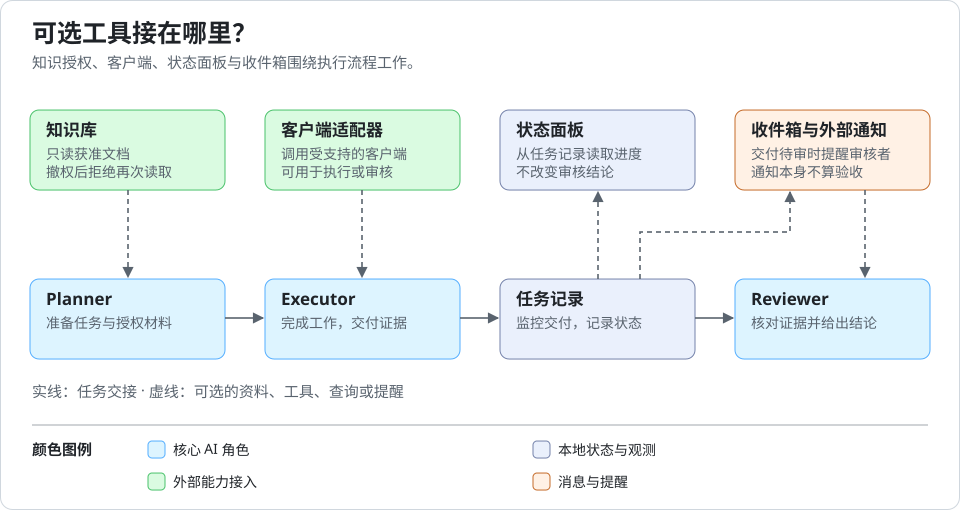

# Agent Workflow Orchestrator (AWO)

[English](README.md) | 中文

AWO 让一个 AI 规划任务，另一个执行，再由独立审核者根据证据决定是否完成。你指定目标和权限，本地台账记录每一步。可以直接使用 AWO，也可选用 MAID 作为秘书。

## 怎么运作

任务只派发一次；后台监测交付，审核者决定接受、返修或拒绝。任务可以并行，有依赖的步骤等前置任务通过后再开始。

## 核心能力与安全底线

客户端适配器连接不同执行工具；面板显示状态，收件箱传递提醒。项目知识可按主题检索并返回出处：先验证权限，撤权后阻止后续读取。配置本身不授权派工；不会自动批准权限提示，执行者不能自审。

## 让 AI 帮你部署

~~~text
请按 agent-workflow-orchestrator 仓库的 docs/setup.zh-CN.md 帮我部署。先检查 Git、Python 3.10+ 和已安装客户端；询问目标目录，仅在新的子目录中使用手册指定的正式版本。只运行 demo_scheduler.py 和 workflow_control.py status 自检，演示状态写入新的临时目录。不要修改我的项目、账号或密钥，不调用付费模型、不真实派工。汇报检查结果和下一条命令，等我决定。
~~~

## 详细手册

[手动配置与文档导航](docs/setup.zh-CN.md) | [知识检索与术语表](references/material-packets.md)
