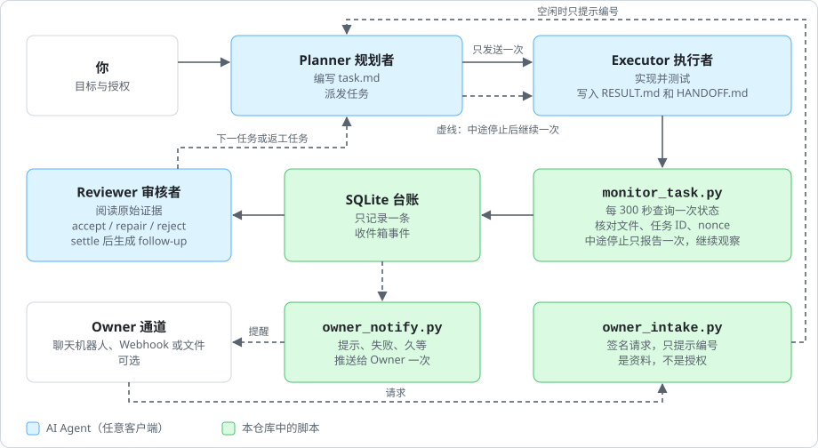
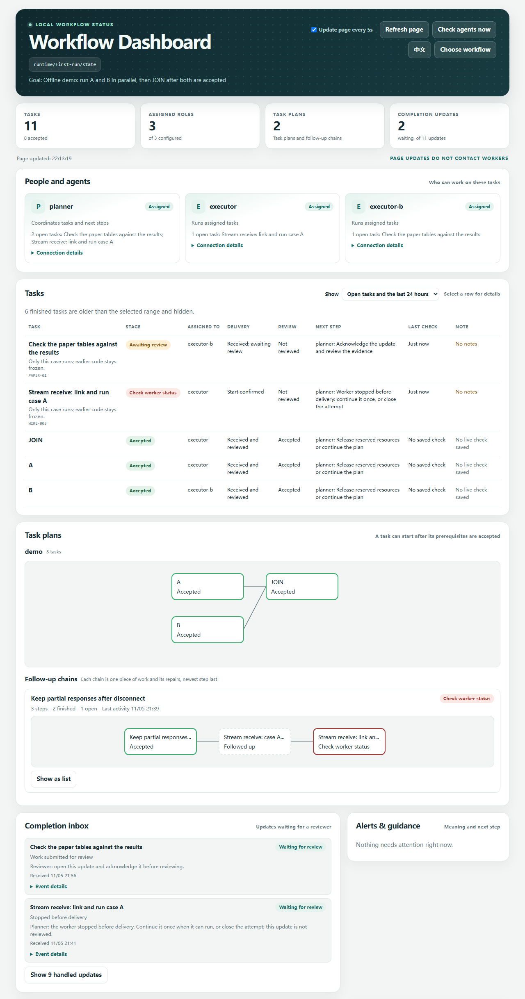

# Agent Workflow Orchestrator

[English](README.md) | 中文

让一个 AI Agent 负责规划和审核，另一个负责执行。你只需给出目标、说明允许做什么；Agent 之间通过本地台账交接任务，未经审核的都不算完成。



## 怎么运作

1. **Planner** 写好任务，向 **Executor** 只发送一次。
2. 后台脚本查询 Executor 的状态。它从不让模型重读对话，所以监控几乎不耗费额度。
3. 约定的文件交付后，**Reviewer** 收到一条更新，阅读证据后作出结论：通过、返工或拒绝。
4. 你允许的话，接着做下一个任务；不允许的话，Agent 停下来向你报告。

角色与客户端无关：Planner 可以在 Codex 里，Executor 可以在 Claude 里，也可以使用其他受支持的组合。兼容性按客户端版本核验，不能从 harness 名称推断；见[适配器说明](references/harness-adapters.zh-CN.md)。“只发一次、审核后才算完成、同一时间只有一个控制者”这些规则由 `scripts/` 里的脚本强制执行，而不是靠提示词。`SKILL.md` 告诉控制者 Agent 何时运行这些脚本。

## 开始使用

1. **安装。** 把仓库克隆到客户端的 Skill 目录：

   ```sh
   git clone https://github.com/cgy0071/agent-workflow-orchestrator.git "$HOME/.codex/skills/agent-workflow-orchestrator"   # Codex
   git clone https://github.com/cgy0071/agent-workflow-orchestrator.git "$HOME/.claude/skills/agent-workflow-orchestrator"  # Claude Code
   ```

   其他客户端（Pi、dsh-tui、Grok 等）通过各自的 Skill 或上下文机制加载 `SKILL.md`。

2. **每个角色开一个窗口**，各自启动客户端，例如 Planner 用 Claude，Executor 用 Codex。

3. **告诉 Planner 要做什么。** 在 Codex 里用 `$agent-workflow-orchestrator`，在 Claude Code 里用 `/agent-workflow-orchestrator`，然后给出目标和范围：

   ```text
   为这个目标建立 Planner/Executor 工作流：给 /users 接口加分页。
   在这个目标范围内可以派发、监控和审核，其他事情先问我。
   ```

   Agent 会生成工作流配置、绑定窗口、编写任务、派发并监控；需要你决定时会来问你。

4. **查看和决定。** 让 Agent“打开状态面板”，或双击 `dashboard.cmd`（Windows）/ `dashboard.command`（macOS）。面板显示进行中的任务、等待审核的更新和提醒；不加操作选项启动时只读。



留给你的事：目标和 Agent 能做到哪一步、各 Agent 窗口里的授权提示、以及你没有委托出去的审核。想逐步手动操作，见[手动操作指南](references/manual-workflow.zh-CN.md)。

## 第一次真实运行

需要 Python 3.10+ 和已安装并登录的 Codex CLI。在仓库根目录运行，每次使用新目录。这会在一次性测试上产生三次真实模型轮次，任何审核闸门失败都会停止：

```powershell
Remove-Item Env:HERDR_ENV -ErrorAction SilentlyContinue
python -B scripts/validate_v2_native_loop.py --directory runtime/repro/native-oneshot-1 --harness codex --mode one-shot --timeout 240
```

通过时输出 `V2_NATIVE_LOOP_PASS` 并以 0 退出。它证明已安装客户端、单次会话、依赖闸门和目录产物任务上的独立审核；不证明 Herdr、运行中转向或重启恢复、费用、provider／model 身份或 worktree／代码任务行为。[第一次真实运行指南](references/first-real-run.zh-CN.md)还包括会话续用和可选的 Herdr 分屏路径。Git worktree 和代码任务行为另见 [worktree 代码闭环](references/worktree-code-loop.zh-CN.md)。

## 离线演示（仅机制）

需要 Python 3.10+，不需要 Agent 账号或网络。在仓库根目录运行，每次使用新目录：

```sh
python -B scripts/demo_scheduler.py --directory runtime/first-run
python -B scripts/workflow_control.py --state runtime/first-run/state status --summary --format text
```

任务 A 和 B 在两个模拟 Worker 上并行运行；JOIN 要等两者都审核通过后才开始。第一条命令输出 `OFFLINE_DEMO_PASS`，状态里三个任务都是 `accepted`。这证明本地 DAG、依赖和审核机制，worker 是 Python 子进程，不代表 Harness 兼容性。

## 安全要点

- **配置不等于授权。** 派发、通知和连续运行都需要你明确同意。
- **审核后才算完成。** 窗口空闲或退出码为 0 都不算通过，接受也不等于落地。
- **每个任务只发一次。** 发送结果不确定时记录下来等人查看，不会盲目重发；授权提示从不自动回答。
- **只有一个控制者，不能自审。** 切换后旧窗口失去权限；Worker 不能审核自己的任务。
- **外部请求只是资料。** 从聊天通道来的请求，没有你的直接同意不会开始工作。

一次通过只认证它实际运行的范围。目录产物校验不认证 Git worktree 或代码任务；优先级不是运行中转向；预算准入与结算不会停止进行中的调用；旧版知识来源可能仍然未知。

## 可选功能

- **状态面板管理台**（`--allow-manage`）：确认开始、让停顿的 Worker 继续一次、关闭任务、修改限制、分配窗口、查看统计。每个操作先预览，再确认一次。
- **提醒推送给你**（`owner_notify.py`）：授权提示、Worker 提问、失败和久等，可发到文件、Webhook 或命令。
- **接收你的请求**（`owner_intake.py`）：聊天机器人等通道把签名请求放进收件目录；Planner 只收到请求编号。

## 文档

| 主题 | 指南 |
|---|---|
| 逐步手动操作；核心概念、配置文件、完整安全模型、仓库结构 | [manual-workflow.zh-CN.md](references/manual-workflow.zh-CN.md) |
| 设置、绑定、切换窗口、恢复 | [setup-and-switching.zh-CN.md](references/setup-and-switching.zh-CN.md) |
| 第一次真实运行：原生单次、会话续用、可选 Herdr 路径、限制 | [first-real-run.zh-CN.md](references/first-real-run.zh-CN.md) |
| 监控、状态面板、提醒、Owner 收件 | [monitoring.zh-CN.md](references/monitoring.zh-CN.md) |
| 派发、并行任务计划、继续执行 | [scheduling.zh-CN.md](references/scheduling.zh-CN.md) |
| 客户端适配器（Herdr、command、receipt） | [harness-adapters.zh-CN.md](references/harness-adapters.zh-CN.md) |
| 角色、任务与审核模板、任务状态 | [roles.zh-CN.md](references/roles.zh-CN.md)、[task-and-review.zh-CN.md](references/task-and-review.zh-CN.md)、[task-state-machine.zh-CN.md](references/task-state-machine.zh-CN.md) |
| 可选：用手机远程使用命令行（Windows，经 Tailscale 的 SSH） | [remote-access.zh-CN.md](references/remote-access.zh-CN.md) |
| Owner 请求的通道约定 | [owner-intake.zh-CN.md](references/owner-intake.zh-CN.md) |
| 可选 V2 服务边界：增量 schema、dry-run 迁移、freeze/epoch | [awo-service.zh-CN.md](references/awo-service.zh-CN.md) |
| Agent 注册表：enrollment grant、能力证据、心跳、撤销 | [awo-registry.zh-CN.md](references/awo-registry.zh-CN.md) |
| 预算账本：分 scope 预留、用量/暴露、authoritative close | [awo-budget.zh-CN.md](references/awo-budget.zh-CN.md) |
| 优先级调度器：排队顺序、协作槽位、占用、准入闸门 | [awo-scheduler.zh-CN.md](references/awo-scheduler.zh-CN.md) |
| Assignment 工作区：隔离根目录、Git worktree、冻结源 | [awo-workspaces.zh-CN.md](references/awo-workspaces.zh-CN.md) |
| 持久化 Agent 消息：task/run 范围收件箱、回复、确认 | [awo-messaging.zh-CN.md](references/awo-messaging.zh-CN.md) |
| 本地知识与文档：按 scope 登记和检索 | [awo-knowledge.zh-CN.md](references/awo-knowledge.zh-CN.md) |
| 网关与应用传输：处理器、路由、重放规则 | [awo-gateway.zh-CN.md](references/awo-gateway.zh-CN.md) |
| 协作运行时：Fanout、Ensemble、共享预算、有界返工 | [awo-collaboration.zh-CN.md](references/awo-collaboration.zh-CN.md) |
| 合并队列：已接受基线、物化闸门、按 ticket 绑定的 intent | [awo-merge.zh-CN.md](references/awo-merge.zh-CN.md) |
| 端到端 Git worktree 代码闭环：真实 worktree 执行、独立审核、本地 Merge Queue、物化 | [worktree-code-loop.zh-CN.md](references/worktree-code-loop.zh-CN.md) |
| 本地监督与配对外部草稿（本地标签协议，非认证 A2A） | [awo-supervision.zh-CN.md](references/awo-supervision.zh-CN.md) |
| 只读运行视图与隔离审计回执 | [awo-observability.zh-CN.md](references/awo-observability.zh-CN.md) |
| 各版本改了什么 | [CHANGELOG.zh-CN.md](CHANGELOG.zh-CN.md) |

英文入口文件只用 ASCII；中文翻译放在 `*.zh-CN.md`，两种语言同步更新。
