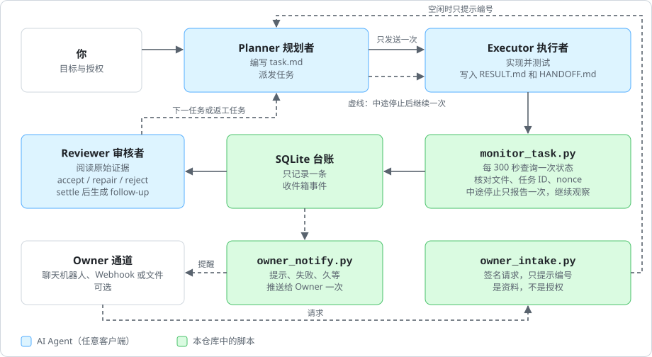

# Agent Workflow Orchestrator

[English](README.md) | 中文

**两个 AI agent 分工干活，交接不靠对话，靠磁盘上的一份任务台账。**
一个负责规划和审核，一个负责执行。每条任务只派发一次，没通过独立审核的不算完成——这些规则由 `scripts/` 里的脚本强制，不靠提示词自觉。

**[安装 Windows 知识库插件（0.4.1 正式版）](https://github.com/cgy0071/agent-workflow-orchestrator/releases/tag/kb-v0.4.1)**：用 Python 3.10+ 或 Anaconda 读取一条示例知识记录。

**[试用 Windows 宿主的任务知识库](https://github.com/cgy0071/agent-workflow-orchestrator/releases/tag/kb-host-v0.1.0-preview.1)** - 从预览发布页下载 AWO-Windows-KB-Host ZIP 附件（请勿选择自动生成的 Source code），解压后按页内三条命令运行。成功时会看到项目、修订、引文和 `AWO KB HOST PREVIEW PASS`。 [查看框架后续交付设计](docs/native-framework-delivery.zh-CN.md)

**[下载 Windows 项目命令正式版 0.1.0](https://github.com/cgy0071/agent-workflow-orchestrator/releases/tag/project-cli-v0.1.0)** — 从 Assets 下载 `AWO-Windows-Project-CLI-0.1.0.zip`，解压后在该目录用 Python 3.10+ 运行 `python -B try_project.py`。

[当前源码版的项目命令](docs/project-commands.zh-CN.md)

## 第一次用 Windows 版？从这里下载，无需 Git

**[下载 Windows 64 位便携候选版](https://github.com/cgy0071/agent-workflow-orchestrator/releases/download/v1.0.0-rc.1/AWO-Windows-x64-rc-check.zip)** ｜ [版本说明和校验值](https://github.com/cgy0071/agent-workflow-orchestrator/releases/tag/v1.0.0-rc.1)

1. 下载 ZIP，右键选择 **全部提取**。
2. 打开解压后的文件夹，双击 **开始.cmd**。离线示例自带 Python，无需账号或 API Key。
3. 看到 **A、B、JOIN 三项已验收** 就成功了。关掉窗口，再次双击可查看上次结果。

## 它适合你吗

**适合**，满足任意一条即可：

- 你已经在同时用两个以上的 CLI agent（Claude Code、Codex 等），并且会手动在它们之间复制任务；
- 你要跑一次几十分钟、中途不想盯着看的任务；
- 你需要事后能查清楚：这一步是谁派发的、交付了什么证据、谁批准的。

**不适合**，满足任意一条即不适用：

- 你只用一种 CLI——它自带的 subagent 就够了，不需要跨进程桥接；
- 你想要“给个目标就全自动”——每一步派发、通知、连续运行都要你点头，这是设计选择，不是还没做完；



## 和以前的版本有什么区别？

| 如果你用过…… | 换到 v1.0.0-rc.1 后的区别 |
| --- | --- |
| 以前按源码说明使用的版本 | 现在可以下载自带 Python 的 Windows ZIP，解压后双击运行示例，不必克隆仓库或配置解释器。较深目录下写入任务回执的修复从 preview.1 起就已包含。 |
| v1.0.0-preview.1 便携版 | 双击、离线运行、重开查看还是同一套体验。RC1 把便携包构建脚本纳入源码，可从同一提交和固定的 Python 包重建相同 ZIP；同时补测了 OMP 超时后无法确认进程已终止的情况。 |

如果 preview.1 已经能运行你的工作流，无需为了新功能立即升级。这个候选版交付的是 **Windows 编排工具**；任务派发、审核、A/B/JOIN 示例原来就有。完整 Native Agent Framework 不在这个 ZIP 中。[查看两个标签之间的实际改动](https://github.com/cgy0071/agent-workflow-orchestrator/compare/v1.0.0-preview.1...v1.0.0-rc.1)。

让一个 AI Agent 负责规划和审核，另一个负责执行。你只需给出目标、说明允许做什么；Agent 之间通过本地台账交接任务，未经审核的都不算完成。

## 支持的功能

Windows 便携版可直接运行离线示例。接入真实客户端需单独配置账号和权限。要使用项目知识库等可选功能，请在需要它的项目中按对应指南启用。

| 功能 | 可以做什么 | 使用方式 |
| --- | --- | --- |
| 离线体验 | 解压后双击运行；两个模拟执行者完成 A、B，再验收 JOIN，重开可查看结果。 | [直接体验](references/manual-workflow.zh-CN.md) |
| 角色与独立审核 | 配置规划者、执行者和审核者；核对交付证据，决定通过、返工或拒绝。 | [配置指南](references/task-and-review.zh-CN.md) |
| 任务调度 | 声明依赖、并行和串行步骤；单次派发，处理停顿、继续和交接。 | [配置指南](references/scheduling.zh-CN.md) |
| 执行客户端 | 绑定、切换和恢复执行窗口；按客户端版本核验可用操作，支持命令、回执和可选 Herdr 接入。 | [配置指南](references/harness-adapters.zh-CN.md) |
| 运行面板与通知 | 查看进度和异常；启用管理模式可预览并确认操作；授权后发送文件或 Webhook 提醒。 | [配置指南](references/monitoring.zh-CN.md) |
| 外部请求与远程操作 | 接收签名请求供 Planner 审查；可配置远程终端从手机查看工作。 | [配置指南](references/owner-intake.zh-CN.md) · [补充指南](references/remote-access.zh-CN.md) |
| 项目与代码交付 | 在已有仓库准备任务，用隔离的 Git worktree 执行，独立审核后通过本地合并队列落地或恢复。 | [配置指南](references/project-entry.zh-CN.md) · [补充指南](references/worktree-code-loop.zh-CN.md) |
| 服务与身份 | 迁移前预演、冻结或恢复写入；登记 Agent，核验能力与心跳，撤销身份。 | [需在项目中启用](references/awo-service.zh-CN.md) · [补充指南](references/awo-registry.zh-CN.md) |
| 预算与资源 | 按任务或项目预留并核对用量；按优先级、协作槽位和资源占用决定是否接纳任务。 | [需在项目中启用](references/awo-budget.zh-CN.md) · [补充指南](references/awo-scheduler.zh-CN.md) |
| 工作区与合并队列 | 为任务分配隔离目录或 worktree，固定基线，将已审核变更按票据落地。 | [需在项目中启用](references/awo-workspaces.zh-CN.md) · [补充指南](references/awo-merge.zh-CN.md) |
| 消息与多 Agent 协作 | 按任务收发消息、回复和确认；将任务分给多个执行者，汇总结果，限制预算和返工次数。 | [需在项目中启用](references/awo-messaging.zh-CN.md) · [补充指南](references/awo-collaboration.zh-CN.md) |
| 项目知识与文档 | 按权限列出条目，按 ID 读取正文、来源、版本和审核历史；使用前检查可用状态。 | [安装插件](https://github.com/cgy0071/agent-workflow-orchestrator/releases/tag/kb-v0.4.1) / [服务 API 接入](references/awo-knowledge.zh-CN.md) |
| 应用接入 | 通过 MCP 标准输入输出、HTTP 或 WebSocket 调用已启用的服务工具。 | [需在项目中启用](references/awo-gateway.zh-CN.md) |
| 监督与审计 | 查看本地监督建议、接收配对草稿，按项目查看运行记录并导出审计回执。 | [需在项目中启用](references/awo-supervision.zh-CN.md) · [补充指南](references/awo-observability.zh-CN.md) |

## 离线演示（仅机制）

需要 Python 3.10+，不需要 Agent 账号或网络。在仓库根目录运行，每次使用新目录：

```sh
python -B scripts/demo_scheduler.py --directory runtime/first-run
python -B scripts/workflow_control.py --state runtime/first-run/state status --summary --format text
```

任务 A 和 B 在两个模拟 Worker 上并行运行；JOIN 要等两者都审核通过后才开始。第一条命令输出 `OFFLINE_DEMO_PASS`，状态里三个任务都是 `accepted`。这证明本地 DAG、依赖和审核机制，worker 是 Python 子进程，不代表 Harness 兼容性。

## 怎么运作

1. **Planner** 写好任务，向 **Executor** 只发送一次。
2. 后台脚本查询 Executor 的状态。它从不让模型重读对话，所以监控几乎不耗费额度。
3. 约定的文件交付后，**Reviewer** 收到一条更新，阅读证据后作出结论：通过、返工或拒绝。
4. 你允许的话，接着做下一个任务；不允许的话，Agent 停下来向你报告。

角色与客户端无关：Planner 可以在 Codex 里，Executor 可以在 Claude 里，也可以使用其他受支持的组合。兼容性按客户端版本核验，不能从 harness 名称推断；见[适配器说明](references/harness-adapters.zh-CN.md)。“只发一次、审核后才算完成、同一时间只有一个控制者”这些规则由 `scripts/` 里的脚本强制执行，而不是靠提示词。`SKILL.md` 告诉控制者 Agent 何时运行这些脚本。

## 可选：从源码安装为 Agent 技能

**你需要先准备好：**

- 两个终端窗口，各自能启动一个 CLI agent——一个当 Planner，一个当 Executor；
- 两个 agent 都已登录，且能在无人在场时执行命令；
- 一个可写的项目目录（并行任务需要各自独立的目录）。

1. **安装。** 把仓库克隆到客户端的 Skill 目录：

   ```sh
   git clone https://github.com/cgy0071/agent-workflow-orchestrator.git "$HOME/.codex/skills/agent-workflow-orchestrator"   # Codex
   git clone https://github.com/cgy0071/agent-workflow-orchestrator.git "$HOME/.claude/skills/agent-workflow-orchestrator"  # Claude Code
   ```

   其他客户端（Pi、dsh-tui、Grok 等）通过各自的 Skill 或上下文机制加载 `SKILL.md`。

2. **每个角色开一个窗口**，各自启动客户端，例如 Planner 用 Claude，Executor 用 Codex。

3. **告诉 Planner 要做什么。** 在 Codex 里用 `$agent-workflow-orchestrator`，在 Claude Code 里用 `/agent-workflow-orchestrator`，然后给出目标和范围：

   ```text
   为这个目标建立 Planner/Executor 工作流：给 /users 接口加分页。
   在这个目标范围内可以派发、监控和审核，其他事情先问我。
   ```

   Agent 会生成工作流配置、绑定窗口、编写任务、派发并监控；需要你决定时会来问你。

4. **查看和决定。** 让 Agent“打开状态面板”，或双击 `dashboard.cmd`（Windows）/ `dashboard.command`（macOS）。面板显示进行中的任务、等待审核的更新和提醒；不加操作选项启动时只读。


留给你的事：目标和 Agent 能做到哪一步、各 Agent 窗口里的授权提示、以及你没有委托出去的审核。想逐步手动操作，见[手动操作指南](references/manual-workflow.zh-CN.md)。

## 第一次真实运行

需要 Python 3.10+ 和已安装并登录的 Codex CLI。在仓库根目录运行，每次使用新目录。这会在一次性测试上产生三次真实模型轮次，任何审核闸门失败都会停止：

```powershell
Remove-Item Env:HERDR_ENV -ErrorAction SilentlyContinue
python -B scripts/validate_v2_native_loop.py --directory runtime/repro/native-oneshot-1 --harness codex --mode one-shot --timeout 240
```

通过时输出 `V2_NATIVE_LOOP_PASS` 并以 0 退出。它证明已安装客户端、单次会话、依赖闸门和目录产物任务上的独立审核；不证明 Herdr、运行中转向或重启恢复、费用、provider／model 身份或 worktree／代码任务行为。[第一次真实运行指南](references/first-real-run.zh-CN.md)还包括会话续用和可选的 Herdr 分屏路径。Git worktree 和代码任务行为另见 [worktree 代码闭环](references/worktree-code-loop.zh-CN.md)。

## 可选功能

- **状态面板管理台**（`--allow-manage`）：确认开始、让停顿的 Worker 继续一次、关闭任务、修改限制、分配窗口、查看统计。每个操作先预览，再确认一次。
- **提醒推送给你**（`owner_notify.py`）：授权提示、Worker 提问、失败和久等，可发到文件、Webhook 或命令。
- **接收你的请求**（`owner_intake.py`）：聊天机器人等通道把签名请求放进收件目录；Planner 只收到请求编号。

## 你要接受的约束

这些不是可选开关，是它按设计会拒绝你的事：

- **配置不等于授权。** 派发、通知和连续运行都需要你明确同意。
- **审核后才算完成。** 窗口空闲或退出码为 0 都不算通过。
- **每个任务只发一次。** 发送结果不确定时记录下来等人查看，不会盲目重发；授权提示从不自动回答。
- **只有一个控制者，不能自审。** 切换后旧窗口失去权限；Worker 不能审核自己的任务。
- **外部请求只是资料。** 从聊天通道来的请求，没有你的直接同意不会开始工作。

一次通过只认证它实际运行的范围。目录产物校验不认证 Git worktree 或代码任务；优先级不是运行中转向；预算准入与结算不会停止进行中的调用；旧版知识来源可能仍然未知。

## 已知限制

- 适配器观察的是目标 CLI 的窗口状态和会话标识，这属于**界面契约，不是 API 契约**，客户端升级后可能失效。项目自述：离线测试不能证明对每个客户端版本的在线兼容。
- 已验证的 harness 组合有限；Herdr 是可选的，不装也能用 command 适配器。详见[客户端适配器](references/harness-adapters.zh-CN.md)。
- 全部状态在本地文件系统，不做跨机器汇总。

## 文档

**不知道从哪读：先看[手动操作指南](references/manual-workflow.zh-CN.md)**，它讲核心概念、配置文件、完整安全模型和仓库结构。

| 主题 | 指南 |
|---|---|
| 逐步手动操作；核心概念、配置文件、完整安全模型、仓库结构 | [manual-workflow.zh-CN.md](references/manual-workflow.zh-CN.md) |
| 设置、绑定、切换窗口、恢复 | [setup-and-switching.zh-CN.md](references/setup-and-switching.zh-CN.md) |
| 第一次真实运行：原生单次、会话续用、可选 Herdr 路径、限制 | [first-real-run.zh-CN.md](references/first-real-run.zh-CN.md) |
| 监控、状态面板、提醒、Owner 收件 | [monitoring.zh-CN.md](references/monitoring.zh-CN.md) |
| 派发、并行任务计划、继续执行 | [scheduling.zh-CN.md](references/scheduling.zh-CN.md) |
| 客户端适配器（Herdr、command、receipt） | [harness-adapters.zh-CN.md](references/harness-adapters.zh-CN.md) |
| 角色、任务与审核模板、任务状态 | [roles.zh-CN.md](references/roles.zh-CN.md)、[task-and-review.zh-CN.md](references/task-and-review.zh-CN.md)、[task-state-machine.zh-CN.md](references/task-state-machine.zh-CN.md) |
| 可选：用手机远程使用命令行（Windows，经 Tailscale 的 SSH） | [remote-access.zh-CN.md](references/remote-access.zh-CN.md) |
| Owner 请求的通道约定 | [owner-intake.zh-CN.md](references/owner-intake.zh-CN.md) |
| 可选 V2 服务边界：增量 schema、dry-run 迁移、freeze/epoch | [awo-service.zh-CN.md](references/awo-service.zh-CN.md) |
| Agent 注册表：enrollment grant、能力证据、心跳、撤销 | [awo-registry.zh-CN.md](references/awo-registry.zh-CN.md) |
| 预算账本：分 scope 预留、用量/暴露、authoritative close | [awo-budget.zh-CN.md](references/awo-budget.zh-CN.md) |
| 优先级调度器：排队顺序、协作槽位、占用、准入闸门 | [awo-scheduler.zh-CN.md](references/awo-scheduler.zh-CN.md) |
| Assignment 工作区：隔离根目录、Git worktree、冻结源 | [awo-workspaces.zh-CN.md](references/awo-workspaces.zh-CN.md) |
| 持久化 Agent 消息：task/run 范围收件箱、回复、确认 | [awo-messaging.zh-CN.md](references/awo-messaging.zh-CN.md) |
| 本地知识与文档：按 scope 登记和检索 | [awo-knowledge.zh-CN.md](references/awo-knowledge.zh-CN.md) |
| 网关与应用传输：处理器、路由、重放规则 | [awo-gateway.zh-CN.md](references/awo-gateway.zh-CN.md) |
| 协作运行时：Fanout、Ensemble、共享预算、有界返工 | [awo-collaboration.zh-CN.md](references/awo-collaboration.zh-CN.md) |
| 合并队列：已接受基线、物化闸门、按 ticket 绑定的 intent | [awo-merge.zh-CN.md](references/awo-merge.zh-CN.md) |
| 端到端 Git worktree 代码闭环：真实 worktree 执行、独立审核、本地 Merge Queue、物化 | [worktree-code-loop.zh-CN.md](references/worktree-code-loop.zh-CN.md) |
| 面向已有仓库的项目入口：准备、执行、独立审核、本地落地、恢复 | [project-entry.zh-CN.md](references/project-entry.zh-CN.md) |
| 本地监督与配对外部草稿（本地标签协议，非认证 A2A） | [awo-supervision.zh-CN.md](references/awo-supervision.zh-CN.md) |
| 只读运行视图与隔离审计回执 | [awo-observability.zh-CN.md](references/awo-observability.zh-CN.md) |
| 各版本改了什么 | [CHANGELOG.zh-CN.md](CHANGELOG.zh-CN.md) |

英文入口文件只用 ASCII；中文翻译放在 `*.zh-CN.md`，两种语言同步更新。

## 许可证

RC1 标签包含 [MIT 许可证](https://github.com/cgy0071/agent-workflow-orchestrator/blob/v1.0.0-rc.1/LICENSE)。当前 main 分支根目录尚无 LICENSE 文件。
